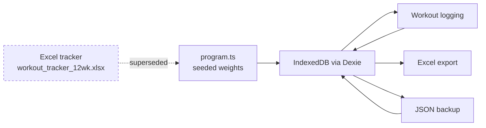

# Docs

Context a future session (human or agent) needs to pick this project up without
re-deriving it. The root [`../README.md`](../README.md) covers setup, features and
the YouTube-link policy — these files cover the _why_, the _state_, and the _decisions_.

| File                                     | What's in it                                                                               |
| ---------------------------------------- | ------------------------------------------------------------------------------------------ |
| [context.md](context.md)                 | Who this is for, the training constraints, and the non-obvious facts that shaped the build |
| [decisions.md](decisions.md)             | Design decisions and the reasoning behind them — read before changing any of them          |
| [operations.md](operations.md)           | How it's hosted, installed, updated and reset. Includes the origin/data-loss trap          |
| [review-findings.md](review-findings.md) | The multi-agent audit: every defect found, its fix, and what was checked and found clean   |
| [open-questions.md](open-questions.md)   | Decisions still owned by the user — nothing here is a bug                                  |

## Status at last update

- **146 unit tests + 10 end-to-end tests passing**; ESLint, Prettier and `tsc -b` clean.
- Deployed to the owner's tailnet, installed as a PWA on a Samsung S22.
- No real training sessions logged yet — destructive resets are still cheap.

