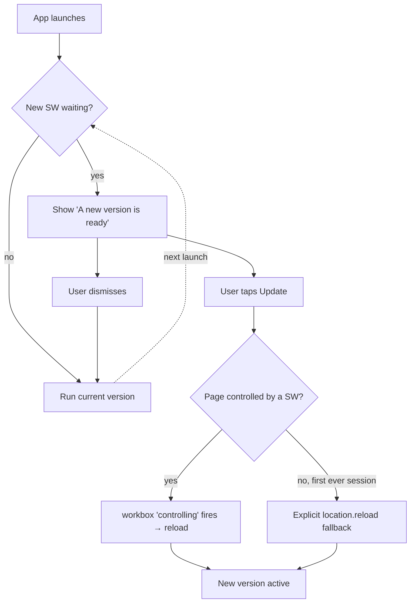

# Decisions

Each of these was deliberate and several were reversals of an earlier approach.
Read the reasoning before changing one.

## Starting weights are seeded, not derived

`program.ts` carries explicit `recommendedWeight` values. A flat 40–60% of a previous
load is the right _idea_ but breaks the moment the movement pattern or implement changes.

| Exercise              | Seeded (kg) | Reasoning                                                                                               |
| --------------------- | ----------- | ------------------------------------------------------------------------------------------------------- |
| Hip thrust            | 60          | Previous best 145 was already a 12–14 rep load; 60 lands 12–20 at 2–3 RIR                               |
| Glute bridge          | 20          | Light DB on the hips                                                                                    |
| Goblet squat          | 16          | **Capped by what a human can hold at the chest.** 50% of the previous box squat would have been 72.5 kg |
| Standing calf raise   | 20          | The source number was contaminated — logged as half of a superset pair with leg extension               |
| Supported split squat | 10          | 2×5 kg, from a Smith BSS at 40                                                                          |
| Farmer carry          | 20          | Per hand. No previous data; conservative                                                                |
| Suitcase carry        | 16          | Per hand                                                                                                |

Everything else is bodyweight or band and carries **no number at all**.

The governing rule is not the percentage — it is _a weight allowing 12–20 clean reps with
2–3 in reserve_. Calibrate on set 1 of week 1.

## Only externally-loaded movements show a weight field

`SetRow.fieldsFor()` takes the exercise's `loadType`. Bodyweight and band movements show
**Reps / RPE / RIR** instead of a dead kg box. A push-up cannot be loaded; offering a
weight input invites meaningless data and pollutes the volume chart.

## `substitutionExerciseId` is what was performed

This is the single most bug-prone concept in the data model.

- `exerciseId` = the **planned slot**.
- `substitutionExerciseId` = **what was actually done**, when the user swapped.

Anything computing a record, total or suggestion must resolve through
`performedExerciseId(result)` in `src/utils/stats.ts`. Matching the raw slot credits
band-assisted pull-up reps to strict pull-ups. This shipped as a real bug and is now
covered by tests in `stats.test.ts` and `progression.test.ts`.

Skipped exercises (`skippedReason != null`) never count toward records or totals.

## Session length is computed, not declared

`WorkoutDay.estimatedMinutes` comes from `estimateSessionMinutes()`, not a hand-written
number. The previous constant was decorative: the test asserting "≤ 60 minutes" compared
the literal `60` against itself and passed while week 4's upper days actually ran to 60
and 62 minutes.

The model walks superset groups (a run chained by `restSeconds: 0` within one block label,
which is also how rest is charged — once per round, not per exercise), prices reps at 3 s,
doubles per-side work, and adds 30 s of transition per exercise. It uses the **top** of
every rep range, so it is a worst case. The warm-up is excluded by design.

Trims applied to bring week 4 inside the target, all spec-compliant:

| Change                                        | Rationale                                                                                                                |
| --------------------------------------------- | ------------------------------------------------------------------------------------------------------------------------ |
| Pull-up/chin-up practice rest 90 → 75 s       | Spec allows 60–90 s for practice singles. Negatives stay at 90 s — the eccentric is the most fatiguing work in the block |
| Strict pull-up sets `[3,4,4,5]` → `[3,4,4,4]` | Spec allows 3–5 sets. Week 4 is the test week; it should not also peak in volume                                         |
| Farmer carry high `[45,45,50,60]` → `[…,50]`  | Base spec is 30–45 s; 60 s overshot even the progression guidance                                                        |
| Dead hang high `[40,45,50,60]` → `[…,50]`     | Same                                                                                                                     |

Backward treadmill was left untouched at 15 min in week 4 — that duration is explicitly
specified and is the whole point of the knee work, despite being the single largest time
cost in the session.

| Week        | Upper A | Lower A | Mobility | Upper B | Lower B |
| ----------- | ------- | ------- | -------- | ------- | ------- |
| Before (W4) | 60      | 58      | 56       | **62**  | 55      |
| After (W4)  | 57      | 58      | 56       | 58      | 55      |

## One canonical program template

`DAY_TEMPLATES` holds five days. All four weeks are generated by applying per-week deltas
(`weekly: { minutes: [8, 10, 12, 15] }`). There is no duplicated week data to drift apart.
Per-day edits are still possible at runtime through the Plan screen.

## Progression is suggested, never applied

A suggestion fires only after **two** sessions where an exercise had all sets completed,
form marked clean, pain 0–2 and every recorded RPE ≤ 7. The user accepts or dismisses.
**Dismissed suggestions are never re-raised** — otherwise a fresh row is minted after every
completed session and duplicates pile up.

## Video links are unverified by default

Every entry in `exerciseVideos.ts` is a YouTube **search URL** with `verified: false`, and
the UI labels those "Search YouTube" rather than "Watch video". Nothing is embedded.
This is a deliberate honesty constraint: an unchecked link must never look like a
hand-verified demonstration. See the root README for how to pin a real video.

## Hash routing

`HashRouter` with `base: './'`. Makes the app portable across any static host and
sub-path without server rewrite rules, at the cost of `#` in URLs. Offline deep-linking
works because the hash never reaches the server and `navigateFallback` serves the
precached shell.

## ExcelJS is lazily imported

~1 MB minified. Loaded on demand via `src/utils/excelModule.ts`, which keeps the entry
chunk at ~530 kB. The `default ?? mod` interop fallback there is **load-bearing** — the
CJS/ESM shape differs between dev pre-bundle and the production chunk. Verified against
the built output; do not "simplify" it away.

## Service worker uses `registerType: 'prompt'`

The user is told a new version exists and taps Update; nothing reloads underneath them
mid-workout.

The `F -- no` branch is not theoretical: on the first-ever session no worker controls the
page, the new worker activates immediately, and workbox's `controlling` event never fires.
Without the fallback the Update button is a silent no-op while the old JS keeps running
against a purged cache.

## Persistence writes the whole session document

`saveSession` does a whole-object `put`. Consequences that are handled, and must stay handled:

- All writers go through a `sessionRef`-backed helper so no write is rebuilt from a stale
  render closure.
- The screen re-reads from IndexedDB on `focus`/`visibilitychange`, so a second window
  (installed app + a leftover browser tab) does not silently clobber the other's sets.
- Elapsed time flushes on a 5 s interval plus `pagehide`/`visibilitychange`, never on a
  debounce keyed on the ticking value.

## Version control

The project is a git repo (`master`, initial commit `18aa2e5`). Deletions are recoverable
from history, but the **user's IndexedDB data is not in git** — a JSON backup is still the
only way to protect logged sessions before anything destructive.
