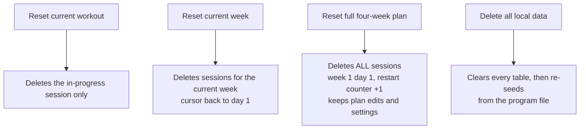

# Operations

## The origin trap — read this first

IndexedDB is scoped **per origin**. The workout history does not follow the app to a
different URL. If the app is ever moved to a new host:

1. Settings → _Export all data as JSON_ on the old origin.
2. Install from the new origin.
3. Settings → _Import JSON backup_.

Choose the permanent URL before logging real sessions, not after.

## Current hosting

Served over the owner's tailnet with real HTTPS (required — a service worker will not
register on a plain `http://192.168.x.x` LAN address; only `localhost` is a trustworthy
origin).

```bash
# 1. Build and serve (loopback only — tailscale serve is the sole way in)
npm run build
npx vite preview --port 4173 --host 127.0.0.1

# 2. Expose over HTTPS to the tailnet (already configured)
tailscale serve --bg --https=8444 http://127.0.0.1:4173

# Live at: https://fedora.taild6580d.ts.net:8444/
# Tear down: tailscale serve --https=8444 off
```

`vite.config.ts` sets `preview.allowedHosts` to include the tailnet hostname — Vite
rejects unknown `Host` headers, so removing that entry breaks phone access.

An existing unrelated serve on `:8443 → localhost:3100` must be left alone.

Caveats of this setup:

- The laptop must be running for the **first** load and for updates. Once installed, the
  service worker serves everything from cache, so a gym with no signal is fine.
- The phone must have Tailscale connected.
- For a setup that survives laptop reboots, deploy `dist/` to any static HTTPS host —
  it is fully static with no backend. Remember the origin trap above.

## Installing on the phone

1. Open the URL in Chrome on the S22.
2. Menu (⋮) → **Install app**.
3. Launch from the icon, then check **More → Settings → Storage** reads **Persistent**.
   Android grants this automatically once installed; "Best effort" means something is wrong.

## Updating

Rebuild (`npm run build`) with the preview server running. On next launch the phone shows
"A new version is ready" → tap **Update**. A plain relaunch does _not_ switch versions, but
the prompt reappears every launch, so there is no way to get permanently stuck.

## Reset paths, weakest to strongest



**Program changes do not need a reset.** The program lives in
`src/data/programs/definitions/hypertrophy-14wk.json`. After a rebuild and update, the app
compares each stored plan with the program file on launch and applies the change itself when
the plan was never edited on the Plan screen — keeping your place and every logged workout.
An edited plan is offered the update on the Plan screen instead. `Delete all local data`
is never needed for this and destroys your history.

## Verification

```bash
npm test          # unit tests
npm run e2e       # end-to-end (builds + previews automatically)
npm run lint
npm run build     # runs tsc -b first
```

The E2E suite binds port 4173, so stop the preview server first or it will reuse it and
then kill it on exit — restart the preview afterwards.

Playwright only has Chromium installed here. The `iPhone SE` device profile needs WebKit;
to check small-screen layout use Chromium with an explicit
`viewport: { width: 320, height: 568 }`.

## Where the data lives

| Store             | Contents                                                         |
| ----------------- | ---------------------------------------------------------------- |
| `plans`           | The single four-week plan, including any per-day edits           |
| `sessions`        | Every logged workout, complete with sets, pain entries and notes |
| `personalRecords` | PRs captured on session completion                               |
| `settings`        | Units, theme, video overrides, weight overrides                  |
| `suggestions`     | Progression suggestions and their accepted/dismissed state       |
| `assessments`     | The end-of-block final assessment                                |
| `importedWeights` | Legacy Excel import staging (unused in practice)                 |

All of it is included in the JSON backup. `meta` is not — nothing writes to it.
