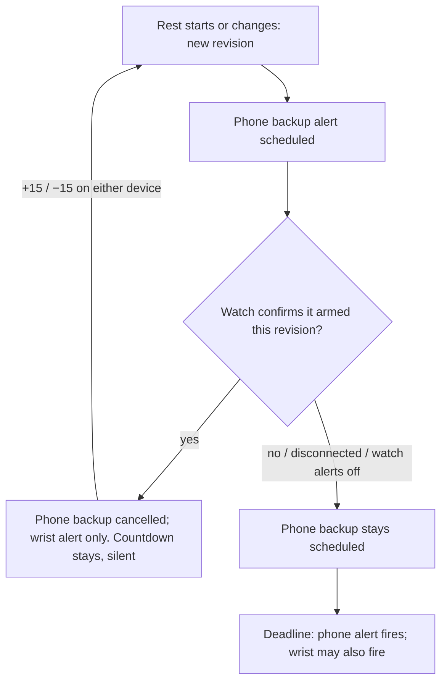

# Screen and rest alerts

Open **More → Settings & Backup → Appearance & timers**.

- **Keep screen on while using the app** prevents automatic dimming/locking while
  Ironpath is visible. The lock is released when you switch apps and requested again
  when you return. The browser may reject it in power-saving mode; Settings shows
  whether the lock is active. Turning the setting off releases it immediately.
- **Notify me when rest ends outside the app** asks the browser for notification
  permission when you enable it. Rest completion shows a notification when Ironpath
  is hidden or unfocused. Tapping it returns to the workout without reloading an
  existing app window. Use **Test rest notification** to check permission and delivery.
- Vibration and the rest beep remain separate settings. A rest-finished message is
  also shown inside the app.

Rest timers use an absolute deadline and live above app navigation. Visiting another
screen does not cancel the countdown. Returning from a suspended page checks the
deadline immediately. Skipping rest or finishing the workout cancels its timer;
starting a new rest replaces it and clears the previous notification.

Both options default to off on existing installs and are saved in JSON backups.
Restoring a preference does not grant browser notification permission on another
device; enable permission there separately.

## Browser limits

Screen wake locks and notifications require a supported browser and a secure origin
(HTTPS, or localhost for development). On phones, use the installed PWA if the browser
does not expose notification permission. OS notification settings still control
whether alerts appear or make a sound.

This is a static offline app, without a push/alarm server. Background timers can be
throttled, suspended, or killed by the browser/OS. Notifications are sent when the
page executes the deadline check, so exact delivery while the screen is locked or
the app is suspended/closed is **not guaranteed**. Keep Ironpath visible with its
screen-on option enabled for the most reliable rest timing. A closed/reloaded app
does not retain a running rest countdown.

References: [Screen Wake Lock API](https://developer.mozilla.org/en-US/docs/Web/API/Screen_Wake_Lock_API),
[mobile notifications](https://developer.mozilla.org/en-US/docs/Web/API/Notifications_API/Using_the_Notifications_API),
[background timer throttling](https://developer.mozilla.org/en-US/docs/Web/API/Page_Visibility_API#policies_in_place_to_aid_background_page_performance).

## Android APK (1.0.2+)

APK builds use native local notifications rather than the browser's Notification
API. Enable the rest-notification switch and allow Android notifications. Tap
**Test rest notification** to schedule an alert three seconds later.

Android schedules the alarm as soon as rest starts; it can deliver even when the
WebView is suspended. From 1.0.6 the rest alarm and lock-screen countdown come
from the native rest coordinator (see [below](#android-apk-106-native-rest-coordinator));
the behaviour described here is otherwise unchanged. Starting another rest replaces the alarm, adding time updates
its deadline, and stopping rest or turning the notification setting off cancels it.
Native alerts may also appear while the app is visible. Tapping the alert opens
the workout. A scheduled alert can survive closing the app, although the onscreen
countdown does not survive a full reload.

Use **Allow precise rest alerts** to grant Android's **Alarms & reminders** access.
Without it, alerts are scheduled as inexact and Android may delay them. Permission
and special settings are requested only through explicit Settings actions.

Even with precise alarms, Android Doze restricts idle alarms to roughly one per
nine minutes; power-saving and notification-channel settings can affect delivery.
Keep the app visible for repeated short rest intervals when exact timing matters.

Implementation follows the [official Capacitor local notifications documentation](https://capacitorjs.com/docs/apis/local-notifications).
The APK's old HTTPS-install advice was incorrect and is fixed in 1.0.2.

## Rest controls and lock screen

- The rest overlay has **−15s** and **+15s**. Deducting to zero ends the rest and
  alerts once. **+15s** on a rest that has just run out restarts it with 15 seconds.
- While resting, the overlay shows what comes next: the next set of the exercise you
  are on, or the first set of the next exercise once it is finished (supersets walk
  A1 → A2 → A1). It includes the target reps and the load to use.

### Android APK 1.0.6+: native rest coordinator

On Android the rest timer is owned by a native **rest coordinator** on the phone
rather than by the WebView. Starting, adjusting and skipping a rest are stored
natively, so they keep working while the app is suspended. With the Galaxy Watch
companion (watch 0.5.0) the same timer is shared: a rest started, extended,
shortened or skipped on either device shows on both.

- **Lock-screen countdown.** `PhoneRestAlerts`, driven by the coordinator, posts an
  ongoing **Rest countdown** notification with a live countdown and the next set
  whenever a rest is running (Android notifications must be allowed for Ironpath).
  It is drawn by Android, so it keeps counting while the app is suspended, and it is
  re-posted on every change (+15, −15, skip, a rest started on the watch). It
  replaces the former `RestLivePlugin`. Lock-screen content follows Android's
  *Notifications on lock screen* setting.
- **"Rest complete" alert.** The coordinator schedules it with Android's alarm
  service (exact when **Alarms & reminders** access is granted, otherwise inexact)
  on the existing rest-notification channel, and it names the next set. It needs the
  **Notify me when rest ends outside the app** switch.

**Alert destination with a watch.** When the watch shares the workout, the wrist
alert is preferred and the phone alert becomes a **backup**:

- Every change to the rest invalidates the watch's confirmation, so the backup is
  scheduled again until the watch re-arms the new deadline.
- If the confirmation never arrives (for example the watch disconnects during the
  rest), both devices can alert. This duplicate is accepted rather than risking no
  alert at all.
- The phone overlay shows the destination: **Alert on your watch**, **Alert on
  watch and phone** (backup still scheduled), or **No alert** (phone notifications
  off and the watch not armed). With the destination on the watch, the phone skips
  its in-app beep and vibration.
- Rest alert scheduling, delivery delay and suppression are recorded in watch sync
  diagnostics (**Settings → Watch sync diagnostics → Export diagnostics**).

iOS, the browser/PWA, and Android builds without the native coordinator keep the
JavaScript timer with local notifications described above. **Test rest
notification** still uses local notifications on all platforms.
