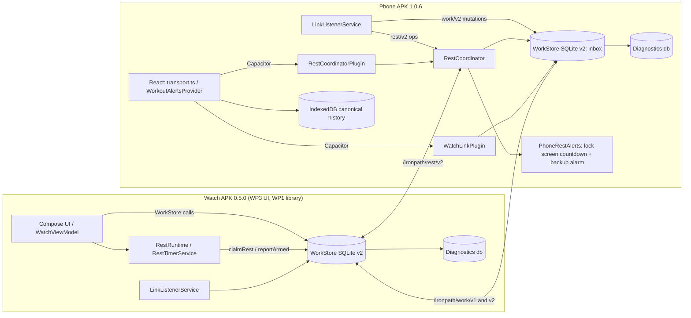
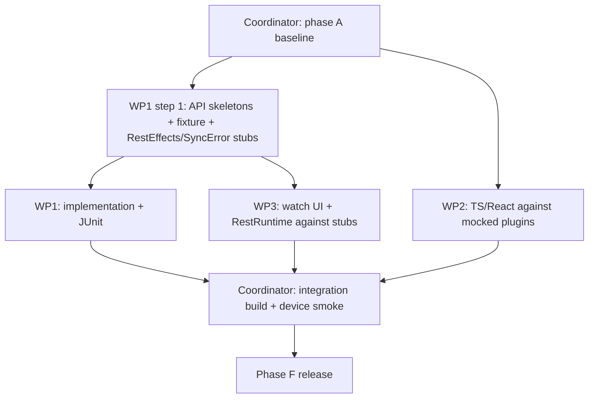

# Galaxy Watch sync v2: design and work packages

Date: 2026-10-22
Status: Design for implementing [sync completion](galaxy-watch-sync-completion.md) phases B–F.
Inputs: [companion spec](galaxy-watch-companion.md), [phase tracker](galaxy-watch-phases.md),
[phase-4 defects](galaxy-watch-phase4-validation.md), [watch UI](galaxy-watch-ui.md) (§10 needs are covered in §6.3 below).

This document is the contract for three agents working in parallel in one worktree.
Exact names, signatures and JSON shapes in it are binding. If an implementer needs to
change one, they tell the coordinator first. They must not change it silently.

---

## 0. Baseline and principles

**Phase A baseline (coordinator, before WPs start).**
- The phone countdown, lock-screen and next-up work is already committed in `7f237bd`.
- Record the results of `npm test`, `npm run typecheck`, `npm run lint` and `npm run watch:test` in the phase tracker.
- Device facts from the user: reconnect and undo passed, and battery looks acceptable. Screen-off alerts are not yet tested.

**Principles**

1. **History.** IndexedDB stays the canonical workout history. Native SQLite holds the transport queues, the canonical rest timer (phone coordinator) and diagnostics.
2. **Two streams.**
   - Workout *mutations* are committed by phone JavaScript, so they wait for the WebView.
   - *Rest operations* are committed natively by the phone `RestCoordinator`, so they never wait for JavaScript.
3. **One rule implementation per platform.**

   | Rule | Implementation | Shared fixture |
   | --- | --- | --- |
   | Field merge | `MutationRules.java` + `src/watch/mutations.ts` | `merge-cases.json` (§2.6) |
   | Rest arithmetic | `RestRules.java` only (both rest roles are Java) | — |
   | Next-up | `NextUp.java` (watch) + `src/utils/nextUp.ts` (phone) | Text format pinned in §1.4 |

4. **Extend, don't rewrite.**
   - `WorkStore`, `WorkProtocol`, `WatchProjection`, `RestState`, `transport.ts`, `sessionSync.ts` and `recovery.ts` are extended.
   - Every v1 path stays working, for draining and for mixed-version pairs.
5. **Retained guarantees.**
   - Peer validation (`phonePeer`/`watchPeer` and peer-matched ACKs).
   - Packet limits: 96 KiB per work packet, 8 KiB per mutation body, 4 KiB per rest packet.
   - Queue limit: `MAX_QUEUED = 200` per direction and type.
   - Replay evidence: the `watch:command:<id>` ledger, epochs and per-device sequences.



---

## 1. Protocol v2 contract

### 1.1 Paths, capabilities and envelope

| Item | v1 (kept) | v2 (new) |
| --- | --- | --- |
| Diagnostic ping path | `/ironpath/link/v1` | unchanged |
| Workout path | `/ironpath/work/v1` | `/ironpath/work/v2` |
| Rest path | — | `/ironpath/rest/v2` |
| Phone capability | `ironpath_phone_v1` | add `ironpath_phone_v2` (keep v1) |
| Watch capability | `ironpath_watch_v1` | add `ironpath_watch_v2` (keep v1) |

**Envelope.** v2 uses the v1 four-key envelope: `{"version":2,"id":"<uuid>","type":"<type>","body":{...}}`.
- Strict JSON with no trailing content, UTF-8.
- The same `decode` hardening as v1.
- A packet is valid only on its own path: work types on `/work/v2`, rest types on `/rest/v2`.

Java constants are added to `WorkProtocol`:

```java
public static final String PATH = "/ironpath/work/v1";        // existing, unchanged
public static final String PATH_V2 = "/ironpath/work/v2";
public static final String REST_PATH = "/ironpath/rest/v2";
public static final int MAX_BYTES = 96 * 1024;                // work packets
public static final int MAX_REST_BYTES = 4 * 1024;
public static WorkProtocol decode(byte[] bytes, String path) throws Exception; // dispatches v1/v2 by path
public final int version;                                      // 1 or 2
```

`WorkClient.flush` picks the path from `(version, type)`. The listener routes by path and refuses mismatches.

**Packet types by path.**

| Path | Type | Direction | Durable outbox? |
| --- | --- | --- | --- |
| work/v2 | `hello` | both | no (re-sent on every capability change and on resume) |
| work/v2 | `snapshot` | phone→watch | yes, replaceable |
| work/v2 | `mutation` | watch→phone | yes |
| work/v2 | `result` | phone→watch | yes |
| work/v2 | `ack` | both | no (reply) |
| work/v2 | `control` | phone→watch | yes, replaceable |
| work/v2 | `status` | watch→phone | yes, replaceable |
| work/v2 | `diagRequest` | phone→watch | no |
| work/v2 | `diagChunk` | watch→phone | no |
| rest/v2 | `restOp` | watch→phone | yes (limit 50) |
| rest/v2 | `restState` | phone→watch | yes, replaceable |
| rest/v2 | `restArmed` | watch→phone | yes, replaceable per timer |

"Replaceable" means inserting a new row deletes any pending row of the same type, which is the existing snapshot/control behaviour. For `restArmed`, the replacement key is the timer.

### 1.2 Shared value types

TypeScript in `src/watch/protocol.ts` must mirror Java validation exactly. The v1 schemas remain unchanged.

```ts
export const WATCH_PROTOCOL_V2 = 2;
export const WATCH_PROTOCOLS = [1, 2] as const;
export const WATCH_SET_FIELDS = ['completed','reps','repsLeft','repsRight','weight','rpe','rir'] as const;
export type WatchSetField = (typeof WATCH_SET_FIELDS)[number];
const uuid = z.string().uuid();
// `id`, `count`, `metric` and `watchSetStateSchema` are the existing v1 helpers.
const sparseSet = watchSetStateSchema.partial().strict()
  .refine((v) => Object.keys(v).length > 0, 'empty');
const label = z.object({ title: z.string().max(120), text: z.string().max(200) }).strict();
```

Metric ranges are the v1 ranges:
- `reps`, `repsLeft`, `repsRight`, `weight`: 0–100000 or null.
- `rpe`: 0–10.
- `rir`: 0–100.
- `completed`: boolean, never null.

### 1.3 `hello` (both directions) and capability negotiation

```ts
export const helloSchema = z.object({
  role: z.enum(['phone', 'watch']),
  protocols: z.array(z.number().int().min(1).max(99)).min(1).max(8),  // [1,2]
  versionName: z.string().min(1).max(20),       // "1.0.6" / "0.5.0"
  versionCode: z.number().int().positive(),     // 7 / 5
  installId: uuid,                              // watch: WorkStore "device"; phone: new state key "installId"
  reply: z.boolean(),                           // true = do not answer with another hello
  features: z.array(z.enum(['mutations2','rest2','diag1','resolve1'])).max(8),
}).strict();
```

**Storage.** Each side stores the latest hello per node as `peerHello:<nodeId>`, holding `{hello, receivedAtWall}`.

**Shared mode** is on for a phone/watch pair only when all of these hold:
1. Exactly one reachable node advertises `ironpath_watch_v1`, `ironpath_watch_v2` or both. This is the existing one-watch rule.
2. That node's stored hello has `2` in `protocols` and includes the `mutations2` and `rest2` features.
3. The phone has published a v2 snapshot for the selected session.
4. The watch has acknowledged that snapshot as `received`.

```mermaid
sequenceDiagram
  participant P as Phone native
  participant W as Watch native
  Note over P,W: capability change, app start, or resume
  P->>W: hello{role:phone, protocols:[1,2], reply:false}
  W->>P: hello{role:watch, protocols:[1,2], reply:true}
  W->>P: status{...}
  P->>W: diagRequest{afterSeq}
  W->>P: diagChunk*{events, more}
  alt both list protocol 2
    P->>P: compat.sharedMode = true (next Send/refresh publishes snapshot v2)
  else watch is v1 (no hello; capability ironpath_watch_v1 only)
    P->>P: legacy v1 handoff + "Update the watch app to 0.5.0"
  end
```

**Mixed-version behaviour.**

| Phone | Watch | Behaviour |
| --- | --- | --- |
| 1.0.6 | 0.5.0 | Shared mode (v2). |
| 1.0.6 | 0.4.x | No hello arrives, because v1 watches do not listen on `/work/v2`. The phone uses the existing v1 workflow: Send, then **Take control on phone**, with control and pause. The phone's watch card shows *Update the watch app to 0.5.0 to log from both screens*. The phone's own rest uses `RestCoordinator` with alerts on the phone only; no `restState` is sent. |
| 1.0.5 | 0.5.0 | The watch receives a v1 snapshot and no hello. The watch runs **legacy mode**, using the existing v1 `logSet`/`undoLast`/`acceptPhoneValues`/`control` code and its local v1 rest. `inspect().phase = "updateNeeded"` is shown once per version pair, then `syncState = "updateNeeded"` with *Update the phone app to 1.0.6*. |

**Upgrading in the middle of a session.**
- If the phone's selection is a v1 handoff with `owner === 'watch'`, a v2 hello arrives, and the watch outbox is not blocked, the phone automatically publishes a v2 snapshot for the same session with `controlRevision + 1`. The watch then switches that session to shared mode.
- If `owner === 'phone'`, the user presses **Send workout to watch** again.

### 1.4 `snapshot` v2 (phone→watch)

```ts
export const watchStepV2Schema = z.object({
  // --- v1 fields, unchanged ---
  setId: id, prescriptionId: id, exerciseId: id, name: z.string().max(256),
  setNumber: z.number().int().positive(), workingNumber: count, workingTotal: count,
  isWarmUp: z.boolean(), entryStyle: z.string().max(40), loadType: z.string().max(40),
  unit: z.enum(['kg','lb']), target: z.string().max(256), recommendedWeight: metric,
  band: z.string().max(40).nullable(), restAfter: z.number().int().min(0).max(86_400),
  supported: z.boolean(), actual: watchSetStateSchema,
  // --- v2 additions ---
  slot: z.string().max(8).nullable(),           // prescription.slot ('A1'); null outside supersets
  group: z.number().int().min(0).max(400),      // index of prescriptionGroups(day); same group = same superset/block
  bandLabel: z.string().max(40).nullable(),     // bandName(band, settings.bandLabels) for display
  review: z.boolean(),                          // true while an unresolved review targets this set
}).strict();

export const watchSnapshotV2Schema = z.object({
  protocolVersion: z.literal(2),
  epoch: uuid, sessionId: id, revision: count, controlRevision: count,
  title: z.string().max(256),
  status: z.literal('inProgress'),
  elapsedSeconds: z.number().finite().nonnegative(),
  elapsedRunning: z.boolean(),                  // phone stopwatch running at capture
  capturedAtWall: count,                        // phone wall ms at capture; DISPLAY ONLY ("Last synced"), never used for arithmetic
  vibrate: z.boolean(),
  sequences: z.record(uuid, count).refine((v) => Object.keys(v).length <= 32),
  freeze: z.object({ id: uuid, reason: z.enum(['finish','switch']) }).strict().nullable(),
  reviews: z.array(z.object({
    id: uuid,                                   // review id == conflicting opId
    setId: id, origin: z.enum(['watch','phone']),
    code: z.enum(RESULT_CODES), reason: z.string().max(512),
    fields: z.array(z.object({
      field: z.enum(WATCH_SET_FIELDS),
      phone: z.union([z.boolean(), metric]),    // current canonical value
      requested: z.union([z.boolean(), metric]),// value the conflicting op asked for
    }).strict()).max(7),
  }).strict()).max(50),
  phone: z.object({ versionName: z.string().max(20), versionCode: z.number().int().positive() }).strict(),
  steps: z.array(watchStepV2Schema).max(400),
}).strict();
```

**Rules**
- **Elapsed time.** The watch computes elapsed as `elapsedSeconds + (elapsedRunning ? (nowElapsed - receivedElapsed)/1000 : 0)`. It stores `receivedElapsed` and `receivedBoot` when it accepts the snapshot; after a reboot the delta is unknown, so it shows `~`.
- **Phone builds snapshots only from canonical data.** `executionSteps` is extended; ordering stays exactly v1. `reviews` come from the phone review store (§2.4).
- **Size.** A 400-step snapshot must stay under 96 KiB. WP2 adds a test with 400 steps of maximum-length names that asserts `packet()` succeeds or reports the existing friendly error.
- **Acceptance on the watch** keeps every v1 rule (epoch/session, `controlRevision` monotonic, revision monotonic within a session) and adds:
  - A session that is not `same` (different session or epoch) is accepted while outbox mutations are pending only if, for every pending mutation, `sequence <= snapshot.sequences[deviceId]`. That means the phone has already imported them. Otherwise the ACK is `rejected` with `code: "pending"`, and the phone republishes after the next reconcile.
  - `freeze != null` sets the freeze state, as if a `control freeze` with the same id had arrived. `freeze == null` with a higher `controlRevision` clears it.
  - A session id listed in `closedSessions` (watch state, bounded to 20) is refused with `code: "closed"`.

**Next-up text format** (used by the phone notification). `NextUp.java` must produce exactly what `nextUp()`/`nextUpLine()` produce in TypeScript:
- `title`: `"<slot> · <name>"`, or just `"<name>"` when there is no slot.
- `text`: `"Set <i> of <n> · <targetLabel> · <load>"`.
  - `targetLabel` turns `8-12` into `8-12 reps`, and `8 per side` into `8 reps per side`.
  - `load` is `"<w> <unit>"`, or `"<bandLabel> band"`, or omitted.
  - The weight comes from `actual.weight`, then `recommendedWeight`.
- On the watch, `kind` is `set` when the next step has the same `prescriptionId` as the step just completed, and `exercise` otherwise. This matches the UI spec's S4 rule.

### 1.5 `mutation` v2 (watch→phone)

```ts
export const MUTATION_OPS = ['complete','edit','undo','resolve'] as const;
export const watchMutationV2Schema = z.object({
  protocolVersion: z.literal(2),
  opId: uuid,                                   // MUST equal envelope id
  epoch: uuid, sessionId: id,
  deviceId: uuid,                               // same WorkStore "device" as v1
  sequence: count.refine((v) => v > 0),         // same per-epoch counter as v1 ("sequence:<epoch>")
  baseRevision: count,                          // diagnostic only; never a rejection criterion
  controlRevision: count,                       // snapshot generation the watch acted on
  op: z.enum(MUTATION_OPS),
  target: z.object({ prescriptionId: id, exerciseId: id, setId: id }).strict(), // exerciseId = performed id
  expected: watchSetStateSchema.partial().strict(),  // EXACTLY the keys of `changes`
  changes: watchSetStateSchema.partial().strict(),
  undoOf: uuid.nullable(),                      // op==='undo' only
  resolves: uuid.nullable(),                    // op==='resolve' only: review id
  keep: z.enum(['phone','watch']).nullable(),   // op==='resolve' only
  createdAtWall: count,                         // diagnostics only
}).strict().superRefine(mutationShapeRules);
```

`mutationShapeRules` is mirrored in Java as `MutationRules.validateShape(JSONObject)`.

| op | `changes` | `expected` | Other fields |
| --- | --- | --- | --- |
| `complete` | non-empty and contains `completed:true` | same keys as `changes`, with `completed:false` | `undoOf`, `resolves` and `keep` are null |
| `edit` | non-empty, without `completed` | same keys as `changes` | `undoOf`, `resolves` and `keep` are null |
| `undo` | the original op's `expected` | the original op's `changes` | `undoOf` is required |
| `resolve`, `keep:'watch'` | the review's requested values | the review's `phone` values as shown on the watch | `resolves` is required |
| `resolve`, `keep:'phone'` | `{}` | `{}` | `resolves` is required |

A `resolve` with `keep:'watch'` is a conditional mutation that never overwrites blindly. The `{}` changes/expected for `keep:'phone'` are the only allowed empty case.

**What the watch may send.** The watch may send `complete`, `edit`, `undo` and `resolve`. Rest start, adjust, skip and cancel go on the rest stream (§1.8).

**Phone only:**
- start and finish;
- substitutions and skipping an exercise;
- adding or deleting sets;
- warm-up, notes and pain;
- unsupported entry styles;
- band changes.

**Stale targets.** The watch refuses stale targets locally before enqueuing:
- the set is missing from the projection;
- it is not `supported`;
- `review` is true;
- the editor's `expected` differs from the projection;
- the session is frozen or closed;
- the op is `complete` on a completed set.

The phone re-checks everything canonically (§2.2).

### 1.6 `result` v2 (phone→watch) and result codes

```ts
export const RESULT_CODES = ['ok','noop','fieldConflict','setMissing','exerciseChanged',
  'exerciseSkipped','unsupportedStyle','sessionClosed','epochMismatch','sequenceReused',
  'idReused','invalid','reviewMissing','pending','closed','frozen','stale'] as const;
export const watchResultV2Schema = z.object({
  opId: uuid, epoch: z.string().max(36), sessionId: z.string().max(512),
  state: z.enum(['committed','rejected','conflict']),       // 'deferred' is never sent
  code: z.enum(RESULT_CODES),
  revision: count,
  reason: z.string().max(512),
  review: z.boolean(),                                       // true → a review record exists on the phone
  fields: z.array(z.object({ field: z.enum(WATCH_SET_FIELDS),
    phone: z.union([z.boolean(), metric]), requested: z.union([z.boolean(), metric]) }).strict()).max(7),
}).strict();
```

The envelope `id` equals `opId`, as v1 requires for commandId. Watch handling extends the v1 `result` branch:
- `committed` results go into `effects`, as today.
- `conflict` and `rejected` results are stored with their state, but in **v2 mode they do not block all logging**. Only the targeted set shows `review` until a snapshot arrives without that review, or the watch resolves it.

### 1.7 `ack`, `control`, `status` and diagnostics packets

```ts
// ack (reply only). v1 fields + `code`. For type 'control' & state 'received': deviceId, sequence, freezeId.
export const ackV2Schema = z.object({
  type: z.enum(['snapshot','mutation','result','control','status']),
  state: z.enum(['received','rejected']), code: z.enum(RESULT_CODES), reason: z.string().max(512),
  deviceId: uuid.optional(), sequence: count.optional(), freezeId: uuid.nullable().optional(),
}).strict();

export const controlV2Schema = z.object({
  epoch: uuid, sessionId: id, controlRevision: count,
  action: z.enum(['freeze','unfreeze','closed']),
  freezeId: uuid.nullable(),                     // freeze/unfreeze: required; closed: null
  reason: z.enum(['finish','switch','completed','removed','restored']),
}).strict();

export const watchStatusSchema = z.object({     // watch→phone, replaceable
  epoch: uuid.nullable(), sessionId: id.nullable(),
  pendingMutations: count,                       // not yet ACKed 'received' by phone
  receivedMutations: count,                      // ACKed received, no final result yet
  pendingRestOps: count, reviewCount: count, lastSequence: count,
  diagnosticsLastSeq: count, measuredAtWall: count,   // display only
}).strict();

export const diagRequestSchema = z.object({ afterSeq: count, max: z.number().int().min(1).max(150) }).strict();
export const diagChunkSchema = z.object({ events: z.array(diagnosticEventSchema).max(150),
  lastSeq: count, more: z.boolean() }).strict();
```

**Control semantics on the watch** (in one SQLite transaction):
- **freeze.** If `freezeId` is already stored and the body is identical, return the cached ACK. Otherwise:
  - store `freeze = {id, reason, controlRevision}`;
  - block `logSet`, `updateSet`, `undoLast` and `resolveConflict` with `SyncError "frozen"`;
  - leave the rest timer untouched;
  - reply with `ack{deviceId, sequence: current "sequence:<epoch>", freezeId}`;
  - call `retryReceivedCommands()`.
- **unfreeze.** Clear the freeze only if `freezeId` matches the stored one. A stale unfreeze gets an ACK with `rejected`/`stale`.
- **closed.** Add the session to `closedSessions`, set `closed = {sessionId, reason, summary}` and clear the freeze. The local rest projection ends with `state:"cancelled"`. Pending outbox items stay so they can drain.

### 1.8 Rest stream (`/ironpath/rest/v2`)

**Ownership and validity.**
- The phone `RestCoordinator` owns the canonical timer and a global, monotonic `revision` counter (state key `restRevision`).
- The watch keeps the authoritative copy it received plus its own pending ops.
- No raw uptime or wall time ever crosses devices. Only durations measured fresh at send time do.

```ts
export const restOpSchema = z.object({          // watch→phone
  protocolVersion: z.literal(2),
  opId: uuid,                                   // == envelope id
  deviceId: uuid, restSequence: count.refine((v) => v > 0),   // per-device counter "restSequence" (not per epoch)
  epoch: uuid, sessionId: id,
  op: z.enum(['start','adjust','skip','cancel']),
  timerId: uuid,                                // start: new id created by the watch; others: target
  baseRevision: count.nullable(),               // last authoritative revision the watch saw; diagnostics only
  durationMs: z.number().int().min(1000).max(86_400_000).nullable(),  // start only
  deltaMs: z.number().int().min(-3_600_000).max(3_600_000).refine((v) => v !== 0).nullable(), // adjust only
  sourceOp: uuid.nullable(),                    // start: originating mutation opId; cancel: cancel only if timer.sourceOp == this
  reason: z.enum(['user','undo','zeroRest','closed']),
  next: label.nullable(),                       // start only: NextUp text for the phone's lock-screen notification
  clock: z.object({ ageMs: count, uncertain: z.boolean() }).strict(),  // FRESH at each send (see below)
}).strict();

export const restTimerWireSchema = z.object({
  timerId: uuid,
  state: z.enum(['running','ended','skipped','cancelled','replaced']),
  startedAgoMs: count,                          // fresh at send
  remainingMs: count,                           // fresh at send; 0 unless running
  durationMs: z.number().int().min(0).max(86_400_000),
  origin: z.enum(['phone','watch']), originDevice: uuid,
  sourceOp: uuid.nullable(), next: label.nullable(),
  alert: z.object({
    preferred: z.enum(['watch','phone']),
    watchArmedRevision: count.nullable(),
    phoneBackup: z.enum(['scheduled','suppressed','off','delivered']),
  }).strict(),
}).strict();

export const restStateSchema = z.object({       // phone→watch, replaceable
  protocolVersion: z.literal(2),
  epoch: uuid, sessionId: id.nullable(),
  revision: count,                              // global, monotonic coordinator revision
  watermarks: z.record(uuid, count).refine((v) => Object.keys(v).length <= 8), // deviceId → last restSequence consumed
  timer: restTimerWireSchema.nullable(),
  outcomes: z.array(z.object({ opId: uuid,
    outcome: z.enum(['applied','stale','superseded','expired','rejected']) }).strict()).max(16),
}).strict();

export const restArmedSchema = z.object({       // watch→phone, replaceable per timerId
  deviceId: uuid, timerId: uuid, revision: count,   // AUTHORITATIVE revision the armed deadline reflects
  armed: z.boolean(),
  reason: z.enum(['ok','notificationsOff','channelOff','exactDenied','serviceFailed','pendingOps']),
  exact: z.boolean(),
}).strict();
```

**Fresh measurement.**
- Outbox rows for `restOp` and `restState` store an *anchor* in the new `packets.meta` column, never on the wire:
  - `restOp`: `{createdElapsed, createdWall, boot}`;
  - `restState`: `{measuredAgainst:"current"}`.
- `WorkClient.flush` rebuilds `clock`, `remainingMs` and `startedAgoMs` at each send from `SystemClock.elapsedRealtime()`:
  - same boot: `ageMs = nowElapsed - createdElapsed`;
  - after a reboot: `ageMs = max(0, nowWall - createdWall)` with `uncertain = true`; if that is negative or over 24 h, the op is sent with `durationMs` already expired.
- The receiver anchors on its own receive time: `startElapsed = recvElapsed - ageMs` and `endsElapsed = recvElapsed + remainingMs`.
- **Fingerprint.** The stored packet JSON (without `clock`, `remainingMs` and `startedAgoMs`) is the replay fingerprint. Changing the fresh fields between sends is not "ID reused with different content".
- **Ordering.** `restOp`s are processed in `restSequence` order per device. A gap is held in the inbox, with `recvElapsed` stored so that later processing still ages correctly. A `restSequence` at or below the watermark with a new id is `rejected` and recorded in diagnostics.

---

## 2. Merge and acceptance rules

### 2.1 Per-field three-way merge

This is the single rule, implemented as `MutationRules.merge` in Java and `mergeFields` in `src/watch/mutations.ts`. For every field `f` in `changes`:

| `current[f]` (canonical/projection) | Field outcome |
| --- | --- |
| `same(current, changes[f])` | `noop`. Identical repeated changes are idempotent. |
| `same(current, expected[f])` | `apply` |
| otherwise | `conflict` |

- `same(a,b)`: numbers compare by numeric value (`1 == 1.0`), `null` equals only `null`, and booleans compare strictly. This is the existing `WatchProjection.sameValue`.
- **Op outcome is atomic.**
  - If any field conflicts, the op is `conflict`: nothing is applied and a review is recorded.
  - Otherwise, if every field is `noop`, the result is `committed` with code `noop` and the revision is unchanged.
  - Otherwise, apply all `apply` fields and return `committed` with code `ok`.
- After applying, `exercise.completed` is recomputed (all working sets completed), `syncRevision + 1`, and `updatedAt`. This is the existing v1 behaviour.

**Worked cases** (all of these go into the shared fixture):
- **Duplicate completion, same values.** The phone completed with reps 8, then the watch sends `complete {completed:true, reps:8}` from base `{false, null}`. Result: `noop`.
- **Duplicate completion, different reps** (watch reps 10). `completed` is `noop`, `reps` conflicts, so the op conflicts and the set needs review.
- **Different fields on the same set.** The phone changed `weight`, then the watch sends `{completed, reps}`. Result: `apply`.
- **Different sets.** Always independent.

### 2.2 Canonical acceptance order for watch mutations

This lives in `applyWatchMutation`, called from `sessionSync.ts`. It runs in one Dexie transaction over `sessions`, `plans`, `meta` and the review keys, in this order:

1. **Schema.** A parse failure gives `rejected`/`invalid`.
2. **Epoch.** A mismatch gives `rejected`/`epochMismatch`, and a `watch:recovery:<opId>` record is written as in v1.
3. **Ledger.** If `watch:command:<opId>` exists with the same fingerprint, return the cached result. With a different fingerprint, return `rejected`/`idReused`.
4. **Sequence.** Uses the shared key `watch:sequence:<epoch>:<deviceId>` across v1 and v2.
   - `sequence > last+1`: deferred; neither the ledger nor the sequence is touched.
   - `sequence <= last`: `rejected`/`sequenceReused`.
5. **Session.** If it is missing or not `inProgress`: `rejected`/`sessionClosed`, with `review:true` (closed-workout evidence).
6. **`resolve` ops.** If the review `resolves` is missing or already resolved: `committed`/`noop`, so resolving from both devices is idempotent.
   - `keep:'phone'`: mark the review `kept`; `committed`/`ok`.
   - `keep:'watch'`: continue to step 7 with the conditional changes.
7. **Target.**
   - Set or prescription missing: `rejected`/`setMissing` with review.
   - Performed exercise ≠ `target.exerciseId`: `conflict`/`exerciseChanged` with review.
   - Exercise has `skippedReason`: `rejected`/`exerciseSkipped` with review.
   - Entry style not `reps` or `repsPerSide`: `rejected`/`unsupportedStyle` with review.
8. **Merge** (§2.1).
9. **Write.** Write the effect, the ledger row `{fingerprint, command, result}`, the sequence (which terminal conflicts and rejections also consume, as in v1), and any review record. The native result is queued after the transaction, as today.

**v1 commands keep their v1 rule.** A full `expected` must equal the current set. They are not routed through `mergeFields`, so behaviour is unchanged for v0.4 watches.

### 2.3 Phone edits use the same rule

`WorkoutScreen.persist` currently writes the whole document. It is replaced by a patch commit, so the phone no longer loses edits whenever a watch import bumps `syncRevision`:

```ts
// src/watch/mutations.ts
export interface SessionPatch { opId: string; sets: SetPatch[]; exercises: ExercisePatch[]; session: ScalarPatch;
  structure: StructurePatch[]; elapsedSeconds: number }
export function diffSession(base: WorkoutSession, next: WorkoutSession): SessionPatch;
// src/db/repository.ts
export async function commitSessionPatch(sessionId: string, patch: SessionPatch):
  Promise<{ state: 'committed' | 'conflict' | 'closed'; session?: WorkoutSession; reviewId?: string }>;
```

**Field-level parts** use three-way merges through `mergeFields`, with `same` extended to canonical JSON equality for non-numeric values:
- `SetPatch`: every changed `SetResult` field, including the phone-only fields `band`, `durationSeconds`, `distanceMeters` and `treadmill*`.
- `ExercisePatch`: `notes`, `painDuring`, `formGood`, `videoViewed`, `tempo`, `substitutionExerciseId` and `skippedReason`.
- `ScalarPatch`: `warmUp`, `warmUpCompletedAt`, `painBefore`, `sessionNotes` and `bodyweight`.

**Structure guard.** A `StructurePatch` covers adding or deleting sets. It applies only if the stored set-id list for that exercise equals the base list. Otherwise the result is `conflict`/`structureChanged`. That happens only with multiple phone tabs, because the watch never changes structure.

**Elapsed time** keeps the existing max rule.

**Phone-side conflicts** affect only phone input that raced a watch import. The patch is not applied, a review record with `origin:'phone'` is written for set fields, and the screen rebases (§2.5). Non-set field conflicts only toast and refresh.

`saveSession` stays for non-active-session callers.

### 2.4 Reviews (needs-review state)

**Review record.** Stored in `db.meta` under the key `sync:review:<opId>`:
`{ id, origin:'watch'|'phone', sessionId, setId, prescriptionId, exerciseId, code, reason, fields:[{field, phone, requested}], expected, requested, createdAt, resolution: null|'kept'|'applied'|'superseded', resolvedAt, resolvedBy:'phone'|'watch'|null }`.
- `fields[].phone` captures the current value at conflict time. The UI re-reads the live value for display.
- `watchRecoveryActions()` returns v1 ledger/recovery rows and unresolved v2 reviews as one `ReviewItem` union. This keeps the existing callers, and `WatchRecovery.tsx` renders both.

**Resolving on the phone (WP2).**
- **Keep phone values**: `resolution = 'kept'`.
- **Apply watch values**: a phone-origin conditional patch with `expected` = live values shown and `changes` = requested.
  - If it commits: `'applied'`.
  - If it conflicts: the old review becomes `'superseded'` and a new review is created. Nothing is ever overwritten silently.

**Resolving on the watch (WP3 → WP1).** `WorkStore.resolveConflict` enqueues a `resolve` mutation, which the phone applies as in §2.2 step 6.
- Until the result or the next snapshot arrives, the watch shows the review as `queuedResolution`.
- If the phone resolved first, the watch op returns `noop`.

**Effect on the watch.** The snapshot `reviews` list and `step.review` drive the watch:
- a set with an open review cannot be logged or edited until it is resolved;
- other sets stay fully usable;
- the v1 global block applies **only in legacy mode**.

**Finish** is blocked while any unresolved review exists for the session (existing gate, now covering v2 reviews).

### 2.5 Undo semantics

- **Undo stack.** The watch can undo the latest watch-originated `complete` or `edit` in the current session (`lastAction`, depth 1, as today). Undo is unavailable when:
  - the target set has an open review;
  - the session is frozen or closed;
  - the original's result was `rejected` or `conflict` (it never applied, so there is nothing to undo).
- **Undo op.** `changes` = `original.expected` and `expected` = `original.changes`. The normal three-way merge gives:
  - a revert if nothing changed since;
  - `noop` if the set was already reverted (for example, the phone un-ticked it);
  - a review if the set has been changed since.
- **Rapid undo.** If the original is still unsent, both ops are sent in sequence order. The phone applies complete-then-revert, so the net effect is unchanged. The projection already handles this.
- **Rest.** In the same transaction, `undoLast` enqueues a `restOp{op:'cancel', sourceOp: original.opId, reason:'undo'}` and cancels locally only if the projected timer's `sourceOp` equals that op. The coordinator applies the same condition.

### 2.6 Rebasing open editors

**Watch.** The helper is `EditorRebase.java` in wear-link, owned by WP1 and used by WP3's ViewModel. Its input is `{base, draft, touched[]}`, where `base` is the projected `actual` when the editor opened.

```java
public static JSONObject rebase(JSONObject editor, JSONObject latestActual) throws Exception;
// returns {base, draft, touched[], stale:[{field, latest}]}
//  untouched f: base[f]=draft[f]=latest[f]                (silent rebase)
//  touched f, same(latest[f], base[f]): unchanged
//  touched f, !same: keep draft[f], base[f] unchanged, add to stale  → UI "Phone changed this to 10"
public static JSONObject accept(JSONObject editor, String field) throws Exception; // user keeps own value: base[f]=latest[f], drop stale
```

When the user submits, `expected` = `base` restricted to the touched fields plus `completed` (for `complete`). Submitting with stale fields is allowed only after `accept(...)`, which is the explicit override the UI spec describes. Otherwise `logSet` throws `SyncError("stale")`.

**Phone.** A new hook, `useSessionEditor(sessionId)` in `src/state/useSessionEditor.ts`:
- It holds a FIFO of uncommitted `SessionPatch`es.
- The displayed session is the live Dexie session with pending patches re-applied through `mergeFields`.
- A pending patch that now conflicts is dropped and surfaced as a review.
- Focused inputs keep their local draft text (component state) and commit on change/blur. Their `base` is the value at focus time.
- This replaces the existing `sessionRef`/optimistic `syncRevision` increments and the `liveSession` revision comparison.

### 2.7 Shared conformance fixture

**File:** `android/wear-link/src/test/resources/sync-v2/merge-cases.json`.
- Owned by WP1, which must create it first. WP2 reads it and never edits it.
- JUnit reads it from the test classpath. Vitest reads it with `readFileSync(resolve(__dirname, '../../android/wear-link/src/test/resources/sync-v2/merge-cases.json'))`.

```json
{ "version": 1, "cases": [
  { "name": "apply untouched field", "current": {"completed":false,"reps":null,"weight":60},
    "expected": {"completed":false,"reps":null}, "changes": {"completed":true,"reps":8},
    "outcome": "apply", "result": {"completed":true,"reps":8,"weight":60}, "conflicts": [] },
  { "name": "duplicate completion same values", "current": {"completed":true,"reps":8},
    "expected": {"completed":false,"reps":null}, "changes": {"completed":true,"reps":8},
    "outcome": "noop", "result": {"completed":true,"reps":8}, "conflicts": [] },
  { "name": "duplicate completion different reps", "current": {"completed":true,"reps":8},
    "expected": {"completed":false,"reps":null}, "changes": {"completed":true,"reps":10},
    "outcome": "conflict", "result": {"completed":true,"reps":8}, "conflicts": ["reps"] },
  { "name": "numeric equality 60 vs 60.0", "current": {"weight":60.0}, "expected": {"weight":60},
    "changes": {"weight":62.5}, "outcome": "apply", "result": {"weight":62.5}, "conflicts": [] },
  { "name": "zero is not null", "current": {"reps":0}, "expected": {"reps":null}, "changes": {"reps":5},
    "outcome": "conflict", "result": {"reps":0}, "conflicts": ["reps"] },
  { "name": "undo after phone revert is noop", "current": {"completed":false,"reps":null},
    "expected": {"completed":true,"reps":8}, "changes": {"completed":false,"reps":null},
    "outcome": "noop", "result": {"completed":false,"reps":null}, "conflicts": [] },
  { "name": "undo after later edit conflicts", "current": {"completed":true,"reps":9},
    "expected": {"completed":true,"reps":8}, "changes": {"completed":false,"reps":null},
    "outcome": "conflict", "result": {"completed":true,"reps":9}, "conflicts": ["reps"] }
] }
```

Both suites iterate over all cases and assert `outcome`, `result` (the merged fields) and the `conflicts` order, which is `WATCH_SET_FIELDS` order. Either side may propose new cases through the coordinator.

---

## 3. Shared rest timer

### 3.1 Rules (`RestRules.java`, pure, used by phone and watch)

- **Timer record** (stored JSON, a superset of v1 `RestState`):

  ```text
  { id, revision, localRev, sessionId, epoch, state, origin, originDevice, sourceOp,
    durationMs, startElapsed, endsElapsed, endsWall, boot, next, vibrate,
    alert:{preferred, watchArmedRevision, phoneBackup}, uncertain, recovery, test }
  ```

  `active` is kept as `state == "running"` for v1 readers.
- **`start(op)`.** Compute `start = recvElapsed - ageMs` and `ends = start + durationMs`.
  - If a current running timer has `startElapsed > start`, the result is `superseded`: the new timer is recorded as `replaced` and does not become current.
  - Otherwise the current timer becomes `replaced` and the new one becomes current.
  - If `ends <= now`, the state is `ended` and the outcome is `expired`. **No alert is ever scheduled for an expired start.** This covers delayed or offline replays.
- **`adjust(timerId, deltaMs)`.** Applies only if `timerId` is current and running; otherwise `stale`.
  - `ends = max(now, ends + delta)` and `durationMs += delta`, clamped to `[0, 86_400_000]`.
  - If `ends == now`, the timer goes through `expire` immediately, so a deduction to zero alerts once, just like phone behaviour today.
  - Concurrent adjustments from both devices commute, and each opId applies once.
- **`skip(timerId)`.** If the timer is current and running, its state becomes `skipped`; otherwise `stale`.
- **`cancel(sourceOp)`.** If the current timer's `sourceOp` equals `sourceOp`, its state becomes `cancelled`; otherwise `stale`.
- **`closeSession(sessionId)`.** If the current timer belongs to that session, its state becomes `cancelled` with reason `closed`.
- **Revision.** Every state change performs `revision++` on the coordinator and `localRev++` wherever the change is stored.
  - Alarms, `claimRest` and notification refreshes are keyed by `(id, localRev)`. A stale callback cannot alert for a newer revision, which is the v1 guarantee.
  - `RestState.extend/stop/recover` are re-implemented on top of `RestRules`, so v1 local timers share the arithmetic.
- **Reboot recovery.** Unchanged: `RestState.recover` re-anchors from `endsWall` when the remaining time is plausible. Otherwise the timer ends with `recovery` text and `uncertain:true`. Expired rests are never replayed.

### 3.2 Phone coordinator

**Classes**

| Class | Location | Responsibility |
| --- | --- | --- |
| `RestCoordinator` | wear-link | Logic and SQLite. Uses `WorkStore`'s database, schema v2. |
| `PhoneRestAlerts` | app | Implements `RestEffects`, which is the Android side effects. |
| `RestAlertReceiver` | app | Handles the alarm and boot. |
| `RestCoordinatorPlugin` | app | The JavaScript bridge. |

**Entry points** all run on a worker thread:
- `LinkListenerService` handles `restOp` and `restArmed` while the WebView is suspended.
- The plugin handles calls from JavaScript.
- The receiver handles alarms and boot.

Each one does the same three things:
1. Run a SQLite transaction through `RestCoordinator`.
2. Run `RestEffects.of(context).apply(context, view)` **after commit**. This is idempotent: it re-arms from stored state.
3. If the selection is in shared mode, queue a replaceable `restState` to the watch and flush.

**Integration with `WorkoutAlertsProvider`: a single scheduler path.**
- When `restCoordinatorSupported()` is true (Android with the plugin), `WorkoutAlertsProvider` stops calling `scheduleNativeRestAlert` and `showNativeRestLive`.
- `rest.start/add/stop` call `RestCoordinator.start/adjust/skip`. The displayed countdown comes from `RestView` (`endsAt = Date.now() + remainingMs` at receipt), updated by the `restChanged` event. Rests started on the watch therefore appear on the phone automatically.
- **Alerts.** `PhoneRestAlerts` owns the lock-screen countdown (the code from `RestLivePlugin`, same notification id 71003 and channel `ironpath-rest-live`) and the backup "Rest complete" alert.
  - The backup alert uses AlarmManager: `setExactAndAllowWhileIdle` when `canScheduleExactAlarms()`, otherwise `setAndAllowWhileIdle`.
  - It posts on the existing `ironpath-rest` channel (same id and settings as the LocalNotifications channel: importance 4, vibration on), with notification id 71001.
- **What JavaScript still does.** `onComplete` only shows the toast and, when in the foreground, plays the beep, if `soundOnRestEnd` is set and `alert.destination !== 'watch'`. It calls `navigator.vibrate` only when `phoneBackup === 'off'` and the destination is not the watch.
- **Upgrade cleanup.** On first launch of 1.0.6, JavaScript calls `cancelNativeRestAlert()` once (meta flag `rest:migratedToCoordinator`). This kills any LocalNotifications rest alarm that 1.0.5 scheduled.
- **Unchanged paths.** iOS, web/PWA and Android without the plugin keep the existing `useRestTimer` + LocalNotifications path. The test alert (id 71002) stays on LocalNotifications.
- **Settings.** JavaScript pushes `configure({notify, vibrate})` on startup and on every change to `notifyOnRestEnd` or `vibrateOnRestEnd`. The values are persisted natively in the state key `restConfig`, because suspended JavaScript cannot be asked for them.

### 3.3 Alert destination and backup until the watch confirms

```mermaid
sequenceDiagram
  participant W as Watch
  participant C as Phone RestCoordinator
  participant A as PhoneRestAlerts
  W->>W: logSet(): mutation + timer(localRev) + restOp(start) in ONE txn; RestRuntime.arm (local first)
  W-->>C: restOp start{ageMs fresh}
  C->>C: RestRules.start → revision r, phoneBackup=scheduled
  C->>A: apply(view): lock-screen countdown + backup alarm(r)
  C-->>W: restState{revision r, remainingMs fresh}
  W->>W: adopt r (no pending ops) → arm alarm/service
  W-->>C: restArmed{timerId, revision r, armed:true}
  C->>C: watchArmedRevision=r → phoneBackup=suppressed
  C->>A: apply(view): cancel backup alarm (countdown stays, silent)
  Note over W: deadline → RestRuntime.deliver(): claimRest → Haptics.restEnd() once
  alt armed never arrives before deadline
    A->>A: backup alarm fires → claim(r) → "Rest complete" (possible duplicate, accepted)
  end
```

- `preferred = 'watch'` whenever the selection is in shared mode and the watch's hello is fresh (received since the last capability change). Otherwise it is `'phone'`.
- `phoneBackup` takes these values:
  - `off` if `notify == false`;
  - `suppressed` if `watchArmedRevision == revision`;
  - `delivered` after it fires;
  - `scheduled` in all other cases.
- **Every new revision invalidates the confirmation.** `+15` re-schedules the backup until the watch re-arms that revision.
- The watch sends `restArmed` only when its projected timer equals the authoritative one, meaning it has no pending rest ops. Otherwise it sends `armed:false, reason:'pendingOps'`, and the phone keeps the backup.
- `restArmed{armed:false}` with `notificationsOff`, `channelOff` or `serviceFailed` keeps the backup and records `rest.fallback`.
- **UI destination** (shown on both devices):
  - `watch` when the phone backup is suppressed and the watch is armed;
  - `phone` when it is not preferred or the watch is not armed;
  - `both` when the backup is scheduled and the watch was armed for an *older* revision;
  - `none` when notify is off on the phone and the watch is not armed.
- **Phone backup delivery.** `RestAlertReceiver` calls `RestCoordinator.claimBackup(timerId, revision)`, a transactional claim that refuses a stale or suppressed revision. If it succeeds, it posts the alert and records `rest.delivered`. If it fails, it records `rest.suppressed{reason:'stale'|'watchArmed'}`.

### 3.4 Watch side of the timer

- **Local first.** `logSet` writes the mutation, timer and `restOp` in one transaction, and the UI then calls `RestRuntime.startFromUser`. This works while disconnected.
- **Applying `restState`** (listener, inside `WorkStore.receive`):
  - Packets whose revision is at or below the last seen revision are ignored.
  - The rule is `authoritative + pending ops`: pending `restOp`s with `restSequence` above the watermark are replayed through `RestRules`, as `WatchProjection` does for mutations.
  - The deadline is re-anchored only when the revision changed or the drift exceeds 1500 ms. This avoids jitter from transit latency.
- **Expired arrival.** A `restState` that arrives with `remainingMs == 0` or a non-running state ends the local timer without an alert, and `localRev++` cancels the alarm.
- **Expiry.** `RestRuntime.deliver(id, localRev)` → `claimRest` → `Haptics.restEnd()` **once**.
  - The "Rest finished" notification is posted only when the activity is not resumed (UI spec §5.5).
  - Diagnostics record `rest.callback` and `rest.delivered`.
- **Rest edits.** `editRest(deltaSeconds, elapsed)` and `skipRest(elapsed)` update the projection locally and enqueue a `restOp`. Phone-started rests appear on the watch through `restState`, with no haptic.

### 3.5 Revision invalidation summary

| Event | Effect |
| --- | --- |
| adjust/skip/cancel/replace/close | `revision++` and `localRev++`; the old alarm PendingIntent is replaced (same request code, `FLAG_UPDATE_CURRENT`, then cancel). `claimRest/claimBackup` with an old `(id, rev)` returns null. |
| undo | Cancel only if `sourceOp` matches (both sides). |
| session closed or switched | `closeSession` on the coordinator; `closed` control on the watch ends its local timer. |
| old `restArmed` | Ignored unless `revision == current.revision`. |
| reboot | `RestState.recover`; never replays. |

---

## 4. Finish barrier and workout switching

```mermaid
sequenceDiagram
  participant UI as Phone WorkoutScreen
  participant T as transport.ts
  participant N as Phone native
  participant W as Watch
  UI->>T: beginFinish(sessionId)
  T->>N: controlWorkout(control v2 freeze{freezeId, reason:finish, controlRevision+1})
  T->>T: selection.freeze={id, reason, phase:'freezing'}; phone inputs disabled
  N-->>W: control freeze
  W->>W: freeze (block mutations, keep rest) → ack{deviceId, sequence S, freezeId}
  W-->>N: ack
  loop until last imported seq ≥ S (16 × 500 ms)
    T->>N: reconcileWatchInbox (imports v1+v2 in sequence order)
  end
  alt unresolved reviews for session
    T-->>UI: show review (freeze held); user resolves or cancels
  end
  alt user confirms & completeSession succeeds
    T->>N: control closed{reason:completed}; RestCoordinator.closeSession
    N-->>W: closed → phase closed (summary)
  else cancel / failure / review abandoned
    T->>N: control unfreeze{freezeId}
    N-->>W: unfreeze (only if freezeId matches)
  end
  opt no ack within timeout
    UI->>UI: confirm "Complete without them?" → offline finish; freeze+closed stay queued
  end
```

`transport.ts` exports, in addition to the v1 exports, which are kept for legacy mode:

```ts
export async function beginFinish(sessionId: string): Promise<{ freezeId: string; checkpointImported: true }>; // throws WatchUnavailableError | WatchReviewRequiredError
export async function cancelFinish(sessionId: string, freezeId: string): Promise<void>;
export async function completeFinish(sessionId: string): Promise<void>;          // queues `closed`, closes rest
export async function switchWatchWorkout(sessionId: string): Promise<string>;    // freeze(reason:'switch') → drain → publish new snapshot
export async function watchSyncStatus(sessionId?: string): Promise<PhoneWatchStatus>;
```

**Finish rules**
- **Order.** `finish()` in `WorkoutScreen` calls `beginFinish`, then the review gate, then `getSession` (latest), then `completeSession`, then `completeFinish`.
  - Any thrown error or cancellation calls `cancelFinish`, which restores normal shared editing.
  - In legacy mode, `prepareWatchFinish` (v1) is used unchanged.
- **Explicit offline finish.**
  - The existing confirmation text is kept, followed by `allowOfflinePhoneControl`-equivalent bookkeeping (`selection.offline = true`).
  - The queued freeze and closed packets stay in the outbox.
  - Later arrivals give `rejected`/`sessionClosed` with review, and the watch S10 variant shows "Some watch sets weren't saved".
- **The watch shows a summary on close.** The `closed` control body is extended only through the watch's own projection. The watch computes `{done, total, elapsedSeconds}` locally when `closed` arrives and stores it in `closed.summary`, so no wire change is needed.

**Workout switching**
- `switchWatchWorkout` runs the same freeze and drain with `reason:'switch'`. Reviews do not block a switch; they stay retained.
- It then closes the old session's rest and publishes the new snapshot with a higher `controlRevision`. The watch accepts it under the §1.4 rule, which uses `sequences` watermarks.
- If the publish ACK is `rejected`/`pending`, the phone retries on each reconcile, up to the barrier timeout. It then shows *Waiting for the watch to finish syncing*.

**Revival protection**
- Closed and restored sessions cannot be revived: the phone checks `inProgress` and epoch, and the watch keeps `closedSessions` and enforces monotonic `controlRevision` and epoch.
- A delayed `freeze` or `unfreeze` with an unknown or older `freezeId` is ignored and ACKed with `stale`.

**Backup restore** keeps the v1 behaviour: the epoch is rotated, the selection deleted and the closed control queued. The restore must also call `RestCoordinator.closeSession(null)`. The `null` means "any", and it cancels the phone timer.

---

## 5. Diagnostics

### 5.1 Store

**Location.** `Diagnostics` is a new `SQLiteOpenHelper` in wear-link, using the file `wear-link-events.db`. It is separate from `WorkStore`, so pruning can never touch pending work, and separate from `LinkStore`.

```sql
CREATE TABLE events (seq INTEGER PRIMARY KEY AUTOINCREMENT, id TEXT NOT NULL, device TEXT NOT NULL,
  type TEXT NOT NULL, at INTEGER NOT NULL, elapsed INTEGER NOT NULL, boot INTEGER NOT NULL,
  session TEXT, timer TEXT, rev INTEGER, op TEXT, data TEXT NOT NULL, UNIQUE(device,id));
```

**Pruning** runs in the same transaction as every insert:

```sql
DELETE FROM events WHERE at < :now - 1209600000;
DELETE FROM events WHERE device = :device AND seq NOT IN
  (SELECT seq FROM events WHERE device = :device ORDER BY seq DESC LIMIT 500);
```

- "500 per device" is enforced per `device` value. The phone stores both `phone` events and imported `watch` events.
- **`record` never throws.** A failure is swallowed and logged with `Log.w`, because diagnostics must never break sync.
- `data` is at most 2 KiB of JSON and holds no exercise values. It does hold IDs.

**Event JSON**, which is also the wire format inside `diagChunk`:

```ts
export const diagnosticEventSchema = z.object({
  id: uuid, seq: count, device: z.enum(['phone','watch']), type: z.string().max(40),
  at: count /* wall ms */, elapsed: count, boot: z.number().int().nonnegative(),
  sessionId: z.string().max(512).nullable(), timerId: uuid.nullable(), revision: count.nullable(),
  opId: uuid.nullable(), data: z.record(z.unknown()),
}).strict();
```

### 5.2 Event types (closed list; `Diagnostics.TYPES` and TS `DIAGNOSTIC_TYPES`)

| Type | Device | `data` fields |
| --- | --- | --- |
| `app.start` | both | `versionName, versionCode, protocols` |
| `perm.snapshot` | both | `notifications, channelImportance, exactAlarms, interruptionFilter, powerSave, batteryOptimized` (recorded on start and when it changes) |
| `sync.peer` | both | `reachable, nodeCount, capability` |
| `sync.hello` | both | `peerProtocols, peerVersion, sharedMode` |
| `sync.snapshot` | both | `revision, controlRevision, bytes, outcome, code` |
| `sync.mutation` | both | `op, sequence, outcome, code` |
| `sync.review` | phone | `code, origin, resolution` |
| `sync.queueFull` | both | `type, count` |
| `sync.storageFailure` | both | `stage, message` |
| `sync.freeze` / `sync.unfreeze` / `sync.closed` | both | `freezeId, reason, checkpoint` |
| `sync.migration` | both | `from, to, pendingV1` |
| `rest.op` | both | `op, origin, outcome, deltaMs` |
| `rest.scheduled` | both | `deadlineWall, remainingMs, exact, scheduler:'alarm'\|'service'\|'both', destination` |
| `rest.armed` | both | `armed, reason, exact` |
| `rest.callback` | both | `expectedElapsed, actualElapsed, delayMs, source:'alarm'\|'service'\|'foreground'\|'receiver'` |
| `rest.delivered` | both | `notificationPosted, vibrationRequested, channelImportance, foreground` |
| `rest.suppressed` | both | `reason:'watchArmed'\|'stale'\|'notificationsOff'\|'expiredOnArrival'\|'superseded'\|'foreground'` |
| `rest.fallback` | phone | `reason:'notArmed'\|'armFailed'\|'disconnected'` |
| `rest.recovered` | both | `uncertain, remainingMs` |
| `rest.failure` | both | `stage, message` |
| `rest.feedback` | both | `felt: boolean`. Only explicit user feedback establishes **physical** vibration. `rest.delivered.vibrationRequested` only records the request. |
| `diag.request` / `diag.import` | phone | `afterSeq, received, more` |
| `js.*` | phone | free-form from JS `recordDiagnostic` (`js.restComplete{delayMs}`, `js.error`) |

### 5.3 Retrieval and export

- **Retrieval on reconnect.** After every hello exchange, the phone sends `diagRequest{afterSeq: watchCursor, max:150}`.
  - The watch replies with chunks of up to 150 events, each chunk at most 96 KiB.
  - The phone imports them with dedupe by `(device,id)`, advances `watchCursor` (WorkStore state `diagWatchCursor`), and requests again while `more` is true.
  - Chunks are not durable; anything missed is fetched on the next reconnect.
- **Export.** `src/watch/diagnostics.ts` builds the export and hands it to the existing share flow, `triggerDownload(blob, filename)` in `src/utils/excelExport.ts`. On native platforms that is Filesystem plus `Share.share`, and on the web a download.
  - Filename: `ironpath-diagnostics-YYYY-MM-DD.json`.
  - Body: `{ format:'ironpath-diagnostics', version:1, exportedAt, phone:{versionName, versionCode, protocols}, watch:{versionName, versionCode, lastRetrievedAt}|null, compat, events:[...] }`.
  - Nothing is uploaded automatically.

---

## 6. Work packages

Three agents work in the same worktree at the same time. **File ownership is exclusive.** Reading other packages' files is fine. Editing them is not.



**Shared-worktree rules (all WPs)**
- **Gradle.** Run every Gradle command through one lock to avoid daemon and lock contention: `flock /mnt/dev/tools/wopwa/android/.gradle/agent.lock ./gradlew ...`. Create the lock directory if it is missing.
- **Git.** Never commit, run `git stash`, run `git checkout --` or reformat files you don't own. The coordinator commits.
- **Coordinator-only work.** Only the coordinator runs `npm run android:sync`, `cap sync` or `android:pair-apks`. Those rewrite `android/app/src/main/assets`.
- **Coordinator-owned files.** `package.json`, `package-lock.json`, `scripts/**`, `plan/**`, `README.md`, `android/build.gradle`, `android/settings.gradle`, `android/variables.gradle`, the version lines in both app Gradle files, and `artifacts/**`. A WP that needs a dependency asks the coordinator.

### 6.1 WP1: native shared library and phone bridge

**Owns:**
- `android/wear-link/**`
- `android/app/src/main/**` (java, `AndroidManifest.xml`, res), except `assets/**`
- `android/app/src/test/**`
- `android/app/build.gradle`, except the `versionCode` and `versionName` lines

**Step 1 must land first, within the first hour.** Compile-ready public classes with the signatures below, using bodies that throw `UnsupportedOperationException`. Step 1 also includes `merge-cases.json` and the new `editRest(int, long)`, alongside a deprecated `editRest(boolean, long)` that delegates, so the current `MainActivity.kt` keeps compiling.

**Files (wear-link `src/main/java/com/ironpath/wearlink/`)**

| File | Change |
| --- | --- |
| `WorkProtocol.java` | v2 envelope, the paths, `decode(bytes, path)`, and `version`. Validation of every v2 body (§1); every zod rule needs a Java equivalent. |
| `MutationRules.java` (new) | `same`, `merge`, `validateShape`, `undoOf`, `WATCH_SET_FIELDS` |
| `WatchProjection.java` | v2 sparse mutations through `MutationRules`. `resolve` ops are not applied to the projection until the result arrives (`keep:'watch'` is projected optimistically). Reviews are applied from the snapshot. |
| `WorkStore.java` | Schema v2 migration (§6.1.1), v2 receive branches, `inspect()` v2, the watch actions below, freeze/closed, hello/status, the coordinator tables |
| `RestRules.java` (new) | Pure rules (§3.1) |
| `RestState.java` | Delegates to `RestRules`; v1 API kept |
| `RestCoordinator.java` (new) | Phone role (§3.2/3.3) and the watch-side `restState` application |
| `RestEffects.java` (new) | Interface plus `Provider` and a no-op default |
| `NextUp.java` (new) | Next step and label text (§1.4) |
| `EditorRebase.java` (new) | §2.6 |
| `SyncError.java` (new) | `IllegalStateException` with a `code` |
| `Diagnostics.java` (new) | §5 |
| `Clock.java` (new) | Clock values |
| `LinkListenerService.java` | Routes the three paths. Sends hello on capability change. Phone: `diagRequest` after hello. Applies effects after rest commits. |
| `WorkClient.java` | Version/path routing, fresh rest clocks at flush, `hello(Context)`, `requestDiagnostics(Context)` |
| `LinkClient.java` | Unchanged |
| `src/main/AndroidManifest.xml` | `MESSAGE_RECEIVED` filters for `/ironpath/work/v2` and `/ironpath/rest/v2` |

**Files (app)**

| File | Change |
| --- | --- |
| `IronpathApplication.java` (new) | Implements `RestEffects.Provider` and returns `PhoneRestAlerts`; records `app.start` and `perm.snapshot` |
| `PhoneRestAlerts.java` (new) | The countdown notification (moved from `RestLivePlugin`), backup alarm and alert posting |
| `RestAlertReceiver.java` (new) | `REST_BACKUP` alarm and `BOOT_COMPLETED` re-arm |
| `RestCoordinatorPlugin.java` (new) | §6.4 |
| `WatchLinkPlugin.java` | §6.4 additions plus the `workChanged` event, through a dynamic receiver for `com.ironpath.app.WORK_CHANGED` while the plugin is loaded |
| `MainActivity.java` | Registers `RestCoordinatorPlugin` |
| `RestLivePlugin.java` | **Deleted**; JavaScript stops calling it in WP2 |
| `AndroidManifest.xml` | `android:name=".IronpathApplication"`, the receiver, and `RECEIVE_BOOT_COMPLETED` |
| `res/values/wear.xml` | Adds `ironpath_phone_v2` |

#### 6.1.1 WorkStore schema v2 migration (`wear-workouts.db` 1 → 2)

`onUpgrade(1,2)`:
1. `ALTER TABLE packets ADD COLUMN meta TEXT`.
2. Insert the state key `schema=2`.
3. Record `sync.migration` with the pending v1 counts.

Nothing is dropped:
- v1 rows in `packets` keep envelope version 1 and are still flushed on `/work/v1`;
- `device` and `sequence:<epoch>` are shared with v2, so identity and sequence history are not reset;
- v1 `rest`, `control` and `lastAction` stay readable.

New state keys:

| Owner | Keys |
| --- | --- |
| Watch | `mode` (`legacy`/`shared`), `freeze`, `closed`, `closedSessions`, `restSequence`, `restLastRevision`, `updateAck` |
| Phone | `installId`, `restRevision`, `restWatermarks`, `restConfig`, `diagWatchCursor` |
| Both | `peerHello:<node>`, `peerReachable` |

**Draining v1.** The phone keeps accepting v1 `command` packets and answering with v1 `result` packets. The watch applies v1 results to v1 commands. A JUnit test opens a v1 database file, created with schema 1 and holding a pending v1 command and a pending v1 control, upgrades it, and drains it.

#### 6.1.2 Public Java API provided by WP1

```java
// Clock.java
public final class Clock { public final long elapsed, wall; public final int boot;
  public Clock(long elapsed, long wall, int boot); public static Clock now(Context c); }

// SyncError.java  — codes: noWorkout frozen closed review stale alreadyCompleted unsupported
//                    queueFull storage legacy noRest test pending
public final class SyncError extends IllegalStateException { public final String code;
  public SyncError(String code, String message); }

// WorkStore.java — watch role (all blocking; call on Dispatchers.IO). Existing methods keep their signatures.
public JSONObject inspect() throws Exception;                         // §6.3 shape; uses Clock.now
public JSONObject inspect(Clock clock) throws Exception;              // tests
public WorkProtocol logSet(String setId, JSONObject expected, JSONObject changes,
                           long elapsed, long wall, int boot) throws Exception; // v2: 'complete' + optional rest start; v1 in legacy
public WorkProtocol updateSet(String setId, JSONObject expected, JSONObject changes) throws Exception; // 'edit' (S2 "Update set")
public void undoLast() throws Exception;                              // v2 undo + rest cancel; v1 in legacy
public WorkProtocol resolveConflict(String conflictId, boolean keepPhone) throws Exception; // 'resolve' mutation
public void editRest(int deltaSeconds, long elapsed) throws Exception; // ±; v2 enqueues restOp adjust
@Deprecated public void editRest(boolean extend, long elapsed) throws Exception; // extend ? editRest(15, e) : skipRest(e); removed at integration
public void skipRest(long elapsed) throws Exception;
public JSONObject claimRest(String id, long localRev, long elapsed) throws Exception; // existing semantics, key = localRev
public void reportArmed(String timerId, long localRev, boolean armed, String reason, boolean exact) throws Exception;
public void recordFeedback(String timerId, boolean felt);             // diagnostics only
public void acknowledgeUpdate(String pairKey) throws Exception;       // S11 shown once per "watchVer|phoneVer"
public void clearClosed() throws Exception;                           // S10 Done → idle (keeps outbox)
public void testRest(long elapsed, long wall, int boot) throws Exception;      // existing
public JSONObject recoverRest(long elapsed, long wall, int boot) throws Exception; // existing
public void acceptPhoneValues() throws Exception;                     // legacy mode only
public void retryReceivedCommands();                                  // existing

// RestEffects.java
public interface RestEffects { void apply(Context context, JSONObject restView);
  interface Provider { RestEffects restEffects(); }
  static RestEffects of(Context c); }          // Application implements Provider, else no-op

// RestCoordinator.java — phone role (static, blocking, worker thread; each returns RestView §6.4)
public static JSONObject view(Context c);
public static JSONObject start(Context c, String sessionId, long durationMs, String sourceOp, JSONObject next);
public static JSONObject adjust(Context c, String timerId, long deltaMs);
public static JSONObject skip(Context c, String timerId);
public static JSONObject closeSession(Context c, String sessionIdOrNull);
public static void configure(Context c, boolean notify, boolean vibrate);
public static JSONObject claimBackup(Context c, String timerId, long revision); // null if stale/suppressed
public static void receive(Context c, String peer, WorkProtocol restPacket);     // listener: restOp/restArmed (phone) or restState (watch)

// Diagnostics.java
public static void record(Context c, String type, JSONObject fields);  // fields may include sessionId,timerId,revision,opId,data
public static JSONArray recent(Context c, String deviceOrNull, int limit); // newest first
public static JSONObject summary(Context c);   // {phone:{count,oldestAt}, watch:{count,oldestAt,lastRetrievedAt}}

// NextUp.java / EditorRebase.java — see §1.4 / §2.6
public static JSONObject compute(JSONObject projectedSnapshot, String lastCompletedSetIdOrNull) throws Exception;

// WorkClient.java (existing + )
public static void hello(Context c) throws Exception;
```

`Diagnostics` is the diagnostics read API that the UI spec requests.

**WP1 consumes nothing from the other WPs.** Its only contract is this document.

**WP1 tests** (JUnit + Robolectric, `android/wear-link/src/test/java/com/ironpath/wearlink/`):
- **`WorkProtocolV2Test`**
  - Every v2 type is accepted.
  - Unknown, extra and missing fields are rejected.
  - Packets on the wrong path are rejected.
  - Oversize packets are rejected: 96 KiB / 8 KiB / 4 KiB.
  - A mutation whose `opId` differs from the envelope id is rejected, as are empty changes outside `resolve`, and mismatched expected/changes keys.
- **`MutationRulesTest`**: runs every case in `merge-cases.json`.
- **`WorkStoreV2Test`**
  - v1→v2 migration with pending v1 work, which keeps its device and sequence.
  - Interleaved v1/v2 sequences.
  - complete/edit/undo/resolve enqueueing and local refusal: stale, review, frozen, closed, unsupported, queue full.
  - Freeze idempotence, and a stale unfreeze being ignored.
  - Switch acceptance rule: watermark ≥ pending sequences.
  - `closedSessions` cannot be revived.
  - Status computation priority.
  - Legacy mode is unchanged: all existing `WorkStoreTest` cases still pass.
- **`RestRulesTest`**
  - Start, supersede and expired arrival.
  - Adjust ± with a deduction to zero.
  - Skip/cancel staleness; a cancel only matches its `sourceOp`.
  - Clamps.
  - Reboot via `RestState`.
- **`RestCoordinatorTest`**
  - Deferred gaps age correctly.
  - The watermark consumes rejected ops.
  - `restArmed` suppresses only the matching revision.
  - A new revision re-schedules the backup.
  - `claimBackup` refuses a stale or suppressed revision.
  - The watch projection replays pending ops over `restState`, and re-anchors only when the revision changes or drift exceeds 1.5 s.
  - `notify=false` gives `phoneBackup=off`.
- **`DiagnosticsTest`**: 500-per-device prune, 14-day prune, dedupe on import, and that `record` never throws, including on a closed database.
- **`NextUpTest`**: label equality with the §1.4 format, covering superset slots, bands, ramp sets and the last set.
- **`EditorRebaseTest`**: silent rebase, stale field, accept.

### 6.2 WP2: phone TypeScript and React

**Owns `src/**`.** Excluded: `src/**` assets used by the build that are generated elsewhere (none today).

**Files**

| File | Change |
| --- | --- |
| `src/watch/protocol.ts` | All v2 schemas, constants and types from §1. v1 is kept, and `packet()` gains a `version` parameter (default 1). |
| `src/watch/mutations.ts` (new) | `mergeFields`, `same`, `diffSession`, `applySessionPatch` and shape rules. |
| `src/watch/sessionSync.ts` | `createWatchSnapshotV2` (extends `executionSteps` with `slot`, `group`, `bandLabel`, `review`, `reviews` and freeze) and `applyWatchMutation` (§2.2). The v1 functions are kept. |
| `src/watch/transport.ts` | Version-aware reconcile (v1 commands and v2 mutations in one sequence order), compat gating, auto-upgrade publish, `beginFinish`/`cancelFinish`/`completeFinish`/`switchWatchWorkout`, `watchSyncStatus`, and the `workChanged` listener trigger. |
| `src/watch/recovery.ts` | The `ReviewItem` union, `resolveReview(id, keep: 'phone'\|'watch')` and v2 review records. |
| `src/watch/restCoordinator.ts` (new) | Typed plugin wrapper plus `restCoordinatorSupported()`. |
| `src/watch/diagnostics.ts` (new) | `loadDiagnostics()`, `exportDiagnostics()` (uses `triggerDownload`) and `recordJsDiagnostic()`. |
| `src/utils/watchLink.ts` | Extends the `WatchLink` typing (§6.4). |
| `src/utils/nativeRestNotifications.ts` | Removes the `RestLive` code. Keeps LocalNotifications for non-coordinator platforms and the test alert. |
| `src/state/WorkoutAlertsProvider.tsx` | Coordinator path (§3.2). `WorkoutRest.start(seconds, next?, ctx?: {sessionId: string; sourceOp?: string})`. |
| `src/hooks/useTimers.ts` | `useRestTimer` accepts an external `{endsAt, total}` source when coordinated. |
| `src/state/useSessionEditor.ts` (new) | Rebasing editor (§2.6). |
| `src/db/repository.ts` | `commitSessionPatch`. |
| `src/utils/backup.ts` | Closes the coordinator timer on restore (§4). |
| `src/screens/WorkoutScreen.tsx` | Uses `useSessionEditor`. The input lock applies only to legacy `owner==='watch'\|'pausing'`. Finish uses the v2 barrier. Rest calls pass `sessionId`. |
| `src/components/WatchWorkoutHandoff.tsx` | Shared-mode card: send/switch, status, update instruction. The take-control UI only appears in legacy mode. |
| `src/components/WatchSyncStatus.tsx` (new) | Status pill: Synced / Saved on watch / Waiting for phone / Needs review / Update needed / Offline. |
| `src/components/WatchRecovery.tsx` | Conflict review: current phone values vs requested values, **Keep phone values** / **Apply watch values**. |
| `src/components/WatchDiagnostics.tsx` (new) | Settings view: summary, latest 100 events, **Fetch from watch**, **Export diagnostics**. |
| `src/components/WatchConnection.tsx` | Shows compat, versions and protocol. |
| `src/screens/SettingsScreen.tsx` | Mounts the diagnostics view. |
| `src/state/AppDataProvider.tsx` | Calls `configure()` on settings change. The `workChanged` listener triggers reconcile; the 2 s poll stays as a fallback. |

**Phone status.** `PhoneWatchStatus` is `{ link: 'off'|'legacy'|'updateRequired'|'offline'|'shared', sync: 'synced'|'savedOnWatch'|'waitingForPhone'|'needsReview', pendingOnWatch, inbox, reviews, peer: {versionName, protocols}|null, lastWatchStatusAt }`. The sync state has this priority:
1. `needsReview` if there are any unresolved reviews for the session;
2. `waitingForPhone` if the native inbox has rows (received but not committed);
3. `savedOnWatch` if the last watch `status` has `pendingMutations + pendingRestOps > 0`;
4. `synced` otherwise.

**WP2 consumes:** the bridge in §6.4 and the fixture in §2.7. Until WP1 lands, it uses vitest mocks of the plugins, following the existing `vi.mock('@/utils/watchLink')` pattern.

**WP2 tests** (vitest):
- **`src/watch/mutations.test.ts`**: the fixture cases, `diffSession` per category, and the structure guard.
- **`sessionSync.test.ts`** (extended):
  - Snapshot v2 fields (`slot`, `group`, reviews, freeze).
  - A 400-step size test.
  - `applyWatchMutation`: different fields on the same set merge; duplicate completion gives noop; a conflict creates a review; exerciseChanged, skipped, setMissing and unsupported cases.
  - Undo noop and undo conflict.
  - Resolve keep/watch, idempotent from both devices.
  - v1 and v2 sequences interleave.
  - Epoch recovery.
- **`transport.test.ts`** (extended):
  - Compat gating and the mixed-version matrix.
  - Auto-upgrade publish.
  - Finish: freeze → drain → review gate → closed.
  - Cancel and failure restore editing.
  - Offline finish.
  - Switching under the pending rule.
  - Delayed freeze ACK before the command (existing regression, in v2).
  - Delayed packets cannot revive a closed session.
- **`useSessionEditor.test.tsx`**: rebase of untouched fields, preservation of the focused draft, conflict to review.
- **`WorkoutAlertsProvider.test.tsx`**:
  - The coordinator path never calls LocalNotifications or RestLive.
  - Watch-origin `restChanged` shows the countdown.
  - No JS vibration when the destination is the watch.
  - The one-time migration cancel.
- **Component tests**: `WatchRecovery` (apply makes a conditional patch, and a conflict is never overwritten), `WatchSyncStatus` (each state), `WatchDiagnostics` (export calls `triggerDownload` with JSON).

### 6.3 WP3: watch Kotlin app

**Owns `android/wear/**`**: `src/main/java/com/ironpath/watch/**`, `res/**`, `AndroidManifest.xml`, `src/test/**` and `build.gradle` except the version lines. It implements the full UI in [galaxy-watch-ui.md](galaxy-watch-ui.md) §10, with its file structure and dependency changes.

**Files.** All files listed in UI §10, plus:
- `WatchApplication.kt` (new): implements `RestEffects.Provider`, whose `apply` calls `RestRuntime.arm(context)`. Add `android:name` to the manifest.
- `Haptics.kt`: `Haptics.restEnd(context)` is the single rest-end waveform, called only from `RestRuntime.deliver()`.
- `res/values/wear.xml`: add `ironpath_watch_v2`.

**`inspect()` JSON consumed by `state/SnapshotParser.kt`.** WP1 provides it; v1 keys are kept for legacy mode.

```jsonc
{
  "phase": "idle|active|resting|finishing|phoneControl|closed|updateNeeded",
  "mode": "none|legacy|shared",
  "syncState": "synced|savedOnWatch|waitingForPhone|needsReview|updateNeeded",
  "sync": { "pendingMutations": 0, "receivedMutations": 0, "pendingRestOps": 0, "reviewCount": 0,
            "phoneReachable": true, "lastSyncedWall": 1729600000000 /* watch wall ms of last committed result or accepted snapshot; null if never */ },
  "peer": { "protocol": 2 /* max common; 1 legacy; null unknown */, "phoneVersion": "1.0.6", "watchVersion": "0.5.0",
            "updatePairKey": "0.5.0|1.0.5" /* null when compatible */, "updateTarget": "phone|watch|null" },
  "workout": null | { "epoch":"…","sessionId":"…","title":"…","revision":41,"controlRevision":7,
            "elapsedSeconds": 2040.0, "elapsedRunning": true, "elapsedReceivedElapsed": 123456789, "elapsedUncertain": false,
            "vibrate": true, "steps": [ /* snapshot v2 steps, projected, + "pending": bool (unconfirmed local change) */ ] },
  "next": null | { "setId":"…","prescriptionId":"…","name":"Bench","slot":"A1","kind":"set|exercise",
            "position":"Set 2 of 4|Ramp 1","target":"8-12","weight":62.5,"unit":"kg","bandLabel":null,
            "supported":true,"title":"A1 · Bench","text":"Set 2 of 4 · 8-12 reps · 62.5 kg" },
  "rest": null | { "timerId":"…","localRev":3,"revision":12 /* null if never confirmed */,
            "state":"running|ended|skipped|cancelled|replaced","endsElapsed":123499999,"remainingMs":84000,
            "durationMs":90000,"origin":"watch|phone","sourceOp":"…","next":{"title":"…","text":"…"},
            "pendingSync":false,"uncertain":false,"recovery":null,"test":false,
            "alert":{"destination":"watch|phone|both|none","armed":true,"reason":"ok"} },
  "undo": null | { "opId":"…","setId":"…","label":"Undo set 2" },
  "conflicts": [ { "id":"…","setId":"…","exerciseName":"Bench","position":"Set 2","origin":"watch|phone",
            "code":"fieldConflict","reason":"…","fields":[{"field":"reps","phone":8,"watch":10}],
            "queuedResolution": null /* "phone"|"watch" while a resolve is pending */ } ],
  "freeze": null | { "id":"…","reason":"finish|switch","sinceWall": 1729600000000 },
  "closed": null | { "sessionId":"…","reason":"completed|removed|restored|replaced",
            "summary":{"done":18,"total":20,"elapsedSeconds":3120},"unsynced": 0 /* >0 → S10 warning variant */ },
  "alerts": { "notifications": true, "exact": true },
  "legacy": null | { "blocked": false, "canUndo": true, "control": null | {"owner":"phone|closed"} }
}
```

**Phase precedence:**
1. `updateNeeded`: the peer is incompatible and `updatePairKey` has not been acknowledged.
2. `closed`.
3. `finishing`: freeze is set.
4. `phoneControl`: legacy control is paused.
5. `idle`: no workout.
6. `resting`: rest is running.
7. `active`.

The UI's `Error` phase is local to the ViewModel, used when `inspect()` throws.

**`syncState` priority** follows UI spec §6: `updateNeeded` > `needsReview` > `waitingForPhone` > `savedOnWatch` > `synced`. Here `waitingForPhone` means items received by the phone but not yet committed, and `savedOnWatch` means items not yet received.

**Action mapping** (ViewModel → WP1):

| UI action | Call |
| --- | --- |
| Done set | `logSet(setId, editor.base, editor.draft, …)` |
| Update set | `updateSet` |
| Undo pill / S6 | `undoLast()` |
| ±15 / Skip | `editRest(±15, elapsed)` / `skipRest(elapsed)` |
| S8 Keep phone / Use watch value | `resolveConflict(id, true/false)` |
| S11 Continue | `acknowledgeUpdate(updatePairKey)` |
| S10 Done | `clearClosed()` |
| Alarm / service expiry | `claimRest` |
| After `arm()` | `reportArmed(timerId, localRev, armed, reason, exact)` |
| S13 | `Diagnostics.recent(context, "watch", 50)` |
| Remote edits while editing | `EditorRebase` |
| Unsupported step **Next** | Local selection only; no call |

After every action: `WorkClient.flush` and `RestRuntime.startFromUser`, which is the existing pattern.

**RestRuntime changes (WP3)**
- `arm()` works from `inspect().rest`, using `localRev` as the alarm extra and calling `reportArmed` after scheduling.
- `deliver()` calls `claimRest`, then `Haptics.restEnd()` once, plus a notification only when the activity is not resumed.
- `deliver()` records `rest.callback` and `rest.delivered` through `Diagnostics.record`.
- `RestTimerService` adds the workout-long ongoing activity (UI §5.7). The FGS stays only during rest.

**WP3 consumes:** §6.1.2 and the `inspect()` JSON above. It provides nothing that the other WPs consume.

**WP3 tests.** Add `testImplementation junit` and `org.json` to `wear/build.gradle`, under `android/wear/src/test/`:
- `SnapshotParserTest`: every phase, every sync state, conflicts, legacy, and missing optional keys.
- `PrefillTest` and `LoadStepsTest`: per UI §5.1/§5.2, including off-grid insertion.
- `PhasePrecedenceTest`: driven by fake `inspect()` JSON.

Compose previews cover all five sync states.

### 6.4 Bridge API (Java ↔ TS)

**`WatchLink`.** Existing methods are unchanged, and each now accepts v1 or v2 packets.

| Method | Args | Resolves |
| --- | --- | --- |
| `publishWorkout` | `{packet}` (v1 or v2 snapshot) | `void` |
| `controlWorkout` | `{packet}` (v1 control, or v2 freeze/unfreeze/closed) | `void` |
| `completeWorkoutCommand` | `{peer, packet}` (v1 or v2 result) | `void` |
| `inspectWorkout` | — | `WatchWorkReport` + `{ watchStatus: WatchStatus \| null, compat: WatchCompat }`. Inbox rows may be v2 `mutation`s. `controlConfirmation.body` may carry `freezeId` and `code`. |
| `flushWorkout` | — | `void` (also sends hello if stale > 60 s) |
| **`compat`** (new) | — | `WatchCompat` |
| **`diagnostics`** (new) | `{limit?: number}` (≤ 1000, default 500) | `{events: DiagnosticEvent[], summary: {phone:{count,oldestAt}, watch:{count,oldestAt,lastRetrievedAt}}}` |
| **`recordDiagnostic`** (new) | `{type: \`js.${string}\`, sessionId?: string, timerId?: string, data?: object}` | `void` |
| **`requestWatchDiagnostics`** (new) | — | `{requested: boolean, reason: '' \| 'noWatch' \| 'legacyWatch'}` |
| event **`workChanged`** | — | `{}` (native inbox, control ACK or watch status changed) |

```ts
export interface WatchCompat {
  phoneProtocols: number[];                    // [1,2]
  peer: { nodeId: string; name: string; reachable: boolean; protocols: number[] | null;
          versionName: string | null; versionCode: number | null; helloAt: number | null } | null;
  sharedMode: boolean;
  reason: 'ok' | 'noWatch' | 'multipleWatches' | 'watchUpdateRequired' | 'helloPending';
}
```

**`RestCoordinator`** is a new plugin. Every method resolves to a `RestView`.

| Method | Args |
| --- | --- |
| `getState` | — |
| `start` | `{sessionId: string \| null, durationSeconds: number (1–86400), sourceOp: string \| null, next: {title: string; text: string} \| null}` |
| `adjust` | `{timerId: string, deltaSeconds: number (±3600, ≠0)}` |
| `skip` | `{timerId: string}` |
| `closeSession` | `{sessionId: string \| null}` |
| `configure` | `{notify: boolean, vibrate: boolean}`; resolves `{}` |
| event **`restChanged`** | `RestView`, retained, so a late listener gets the latest |
| event **`restAlertTapped`** | `{}`; the native alert tap opens the app and JS navigates to `#/workout` |

```ts
export interface RestView {
  measuredAtWall: number;                      // phone Date.now() at measurement (same device → safe)
  timer: null | {
    timerId: string; revision: number; sessionId: string | null;
    state: 'running' | 'ended' | 'skipped' | 'cancelled' | 'replaced';
    remainingMs: number; durationMs: number; origin: 'phone' | 'watch'; sourceOp: string | null;
    next: { title: string; text: string } | null;
    alert: { preferred: 'watch' | 'phone'; destination: 'watch' | 'phone' | 'both' | 'none';
             watchArmedRevision: number | null; phoneBackup: 'scheduled' | 'suppressed' | 'off' | 'delivered' };
  };
}
```

Java returns the same JSON from `RestCoordinator.view` and its peers. `RestCoordinatorPlugin` emits `restChanged` from `PhoneRestAlerts.apply` through a static listener registry while the bridge is alive. Errors reject with `SyncError.code` as the Capacitor error `code`.

---

## 7. Phase F: release (coordinator, after integration)

1. **Integration.**
   - Remove the deprecated `editRest(boolean, long)`.
   - Run `npm test`, `npm run typecheck`, `npm run lint`, `npm run watch:test`, `cd android && ./gradlew :wear:testDebugUnitTest :app:lint :wear:lint :wear-link:lint`, and `npm run android:pair-apks`.
2. **Versions.**

   | File | Change |
   | --- | --- |
   | `package.json` | `"version": "1.0.5"` → `"1.0.6"` (then `npm install --package-lock-only` updates `package-lock.json`) |
   | `android/app/build.gradle` | `versionCode 6` → `7`, `versionName "1.0.5"` → `"1.0.6"` |
   | `android/wear/build.gradle` | `versionCode 4` → `5`, `versionName '0.4.0'` → `'0.5.0'` |
   | `WorkClient.hello` | Reads `versionName` and `versionCode` from `PackageManager`; no hard-coding |

3. **Packaging.** `scripts/package-watch-apks.mjs`:
   - allow the folder `watch-phase6` (the regex becomes `^watch-phase[1-6]$`);
   - for phase 6, write `protocolVersion: 2` and `protocols: [1, 2]`;
   - set the purpose to "Shared phone/watch logging, coordinated rest timer, diagnostics".

   Command, using the delivered 1.0.5 as the certificate baseline:

   ```bash
   APKSIGNER="$ANDROID_HOME/build-tools/36.0.0/apksigner" \
     node scripts/package-watch-apks.mjs artifacts/watch-phase4/ironpath-phone.apk watch-phase6
   ```

   Check that the certificate equals `38255a75…1843`, that `SHA256SUMS` is present, and that `build.json` records the revision and dirty state.
4. **Install in place.** Install the watch with `adb -P 15037 -s <watch> install -r`. Hand the phone APK to the user. Do not clear data on either device.
5. **Device smoke.** Run the device-only items in §8.
6. **Docs.**
   - `plan/galaxy-watch-companion.md`: status, delivered pair, protocol v2 summary, and the replacement of control ownership by shared mode.
   - `plan/galaxy-watch-phases.md`: a new "Sync completion (phone 1.0.6 / watch 0.5.0)" section with validation counts.
   - `plan/galaxy-watch-user-guide.md`: shared logging, status meanings, conflict review, finish behaviour, update order (both apps), diagnostics export, and `artifacts/watch-phase6/`.
   - `plan/galaxy-watch-sync-completion.md`: set the status.
   - `README.md`, lines 75–89: the new pair and the removal of "Take control" from normal use.
7. **Commit and push** to `master`.

---

## 8. Test matrix (maps to "Tests and release acceptance")

Test type: **V** = vitest, **J** = JUnit (wear-link, or wear for the UI parser), **D** = device-only.

| Acceptance item | Test | Type |
| --- | --- | --- |
| Alternate phone/watch logging | `transport.test` shared reconcile; `WorkStoreV2Test` projection | V, J, D |
| Different sets / different fields | fixture "apply untouched field"; `sessionSync.test` field merge | V, J |
| Duplicate completion | fixture noop/conflict cases; `applyWatchMutation` duplicate | V, J |
| Conflicting edits → review | `sessionSync.test` review record; `WatchRecovery` test; `WorkStoreV2Test` set-scoped review | V, J |
| Rapid undo | `WorkStoreV2Test` complete+undo unsent; `sessionSync.test` undo noop/conflict | V, J |
| Stale editors | `EditorRebaseTest`; `useSessionEditor.test`; `WorkStoreV2Test` stale refusal | V, J |
| Disconnect, log independently, restart, reconnect, applied once | `WorkStoreTest` (existing reopen/retry); `transport.test` duplicate delivery; device run with BT off and app kill | V, J, D |
| Delayed / reordered / lost ACKs | existing transport tests + v2 variants; `RestCoordinatorTest` deferred gaps | V, J |
| Full queues, storage failures | `WorkStoreV2Test` queueFull; `sessionSync.test` ledger failure rollback (existing) | V, J |
| Session switching | `transport.test` switch; `WorkStoreV2Test` watermark acceptance | V, J |
| Backup restore | `sessionSync.test` epoch (existing) + rest close on restore | V |
| Finish cancellation | `transport.test` cancel/failure → unfreeze; `WorkStoreV2Test` stale unfreeze | V, J |
| Timer start/extend/skip from either screen | `RestCoordinatorTest`; `WorkoutAlertsProvider.test`; device | J, V, D |
| Clock skew | `RestRulesTest` (only durations cross devices; wall change during rest) | J, D |
| Reboot | `RestStateTest` (existing) + coordinator boot re-arm | J, D |
| Expired replay | `RestRulesTest` expired start, no alert | J |
| Alert-confirmation loss | `RestCoordinatorTest` backup stays scheduled; device: kill watch BT before arm | J, D |
| Cancellation after undo | `RestRulesTest` cancel `sourceOp` match only | J |
| Mixed versions / v1 drain | `transport.test` compat; `WorkStoreV2Test` migration with a v1 database | V, J |
| Malformed / oversize / unknown version | `WorkProtocolV2Test`; `sessionSync.test` validation | J, V |
| Diagnostics bounds, export | `DiagnosticsTest`; `WatchDiagnostics` test | J, V |
| Full suite, typecheck, lint, APK builds, signing | phase F step 1, plus the package script | CI-local |
| Final smoke: both screens, reconnect, finish, several screen-off rests | phone locked; ≥ 10 sets across both screens; ≥ 4 screen-off rests (≥ 1 phone-started, ≥ 1 −15, ≥ 1 skip); then export diagnostics and check `rest.callback.delayMs` | D |

---

## 9. Risks

1. **Phone edit refactor** (whole document → patches, `useSessionEditor`). This is the largest regression surface in `WorkoutScreen`. *Mitigation:* `diffSession` round-trip tests over every `ExerciseCard` action, and keeping `saveSession` for non-active callers.
2. **Rest timing accuracy is bounded by one-way message latency.** Fresh measurement removes queueing delay, but not radio transit time, which is usually under 1 s. A 1.5 s re-anchor threshold prevents jitter. This is documented as an accepted error.
3. **Duplicate alerts** while connectivity is uncertain (the phone backup and the wrist both fire). This is accepted by the plan; diagnostics make it visible.
4. **Two native processes write one SQLite file** on the phone: the listener service and the plugin run in the same app process, but on different threads. *Mitigation:* every `WorkStore`/`RestCoordinator` write is one transaction, and `RestEffects.apply` runs only after commit and is idempotent. Process death between commit and apply is repaired by the next apply, which is triggered by app start, the boot receiver or the next packet.
5. **Android background limits.** These are exact-alarm denial, Doze batching and the watch FGS rules. Delivery is not guaranteed; it is measured through `rest.callback.delayMs`. The phone needs no FGS.
6. **Legacy code retained on the watch** (v1 mode) roughly doubles the state space. *Mitigation:* every existing `WorkStoreTest` must keep passing unchanged, and legacy UI is limited to the S9 "Phone has control" layout plus the existing actions.
7. **Parallel-work coupling.** WP3 cannot compile until WP1's step 1 skeleton exists. Gradle lock contention is handled by `flock`. A schema change after step 1 must go through the coordinator.
8. **Snapshot churn.** In shared mode every phone keystroke can publish a snapshot of up to 96 KiB. *Mitigation:* the outbox replaces any pending snapshot, the phone publishes at most once per second per session, and only after the commit settles.
9. **Migration on real devices.** A v1 database with pending work is upgraded in place on both devices. *Mitigation:* the migration test uses a real schema-1 file, and the device check runs before release with at least one queued v1 action.
10. **Rule drift between TS and Java** for merges. This is caught only for cases that are in the fixture, so new edge cases must be added there first.
