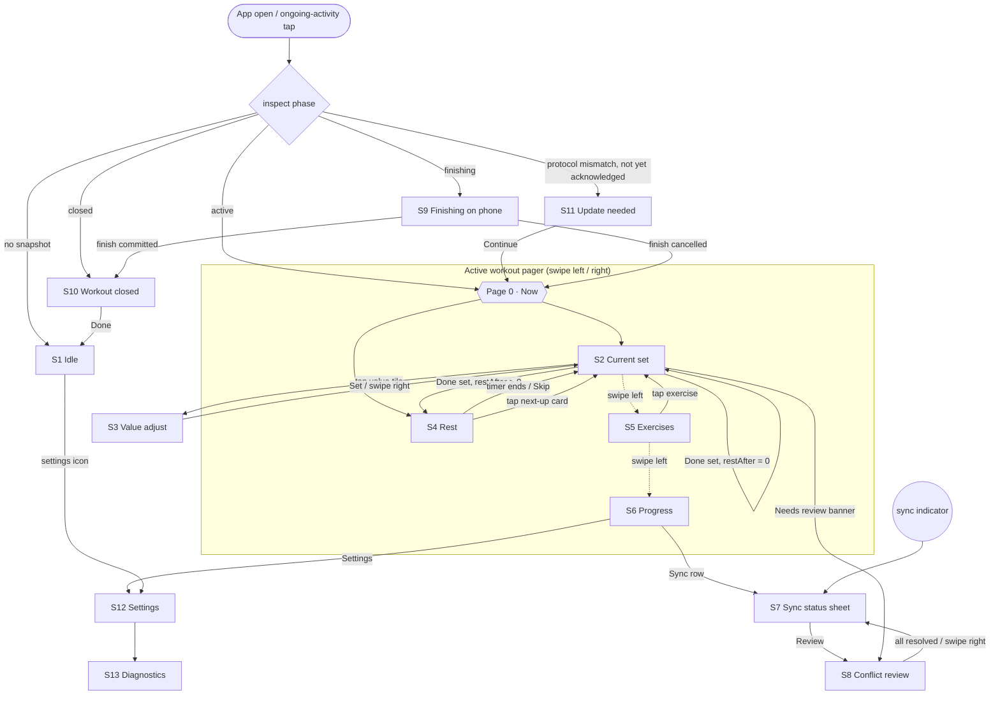
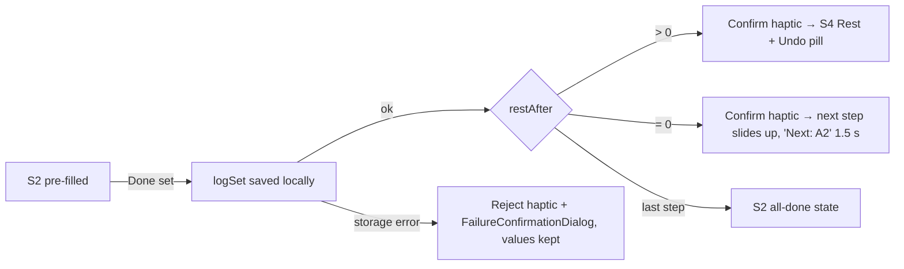

# Galaxy Watch UI redesign

Date: 2026-10-22
Status: Design spec. No code changed yet. This is implemented with phases B–F of [sync completion](galaxy-watch-sync-completion.md) and replaces the single-list UI in `android/wear/.../MainActivity.kt`.
Target: Galaxy Watch7, round 432×432 px (≈192 dp, "small round"). The layout must also work at 227 dp ("large round"). Wear OS 5, touch bezel plus rotary input.

## Why the current UI fails

Everything renders in one `ScalingLazyColumn`: title, messages, set editor, rest, navigation chips, sync counts, permission prompts and debug buttons. On a sweaty, moving wrist you have to scroll to find **Complete set**. The countdown sits among chips. `−`/`+` buttons step weight by 0.5. Raw counts such as "3 pending · open phone to sync" take space on the main screen. "Test wrist alert" and "Test phone connection" are always visible. Nothing uses the crown, ambient mode, haptics or the round edge.

---

## 1. Design principles for a mid-workout wrist

| Principle | Rule applied everywhere |
| --- | --- |
| Glance at arm's length | The key numbers use `numeral*` styles (≥ 30 sp). A screen holds at most 3 text lines besides numbers. The exercise name is the only text longer than 2 words. |
| One primary action per screen | Exactly one `EdgeButton` (Done set / Skip / Set / Done). Secondary actions are smaller and placed above it. |
| Big targets, sweaty fingers | Touch targets ≥ 48 dp. Primary ≥ 70 dp tall (`EdgeButtonSize.Medium`). No two tappable targets closer than 8 dp. Nothing tappable within 8 dp of the bezel except the EdgeButton. |
| Minimal reading | Each state reads as a single short label ("Rest", "Set 2 of 4"). Explanations live in the sync sheet and Settings, not in the workout flow. |
| Rotary for values, touch for decisions | The crown or bezel only changes values or scrolls lists. It never commits, skips or undoes anything. |
| Haptic confirmation | Every commit (Done set, Skip, ±15, undo, conflict choice) gives a `Confirm` haptic. Failures give `Reject`. Each rotary step gives `SegmentTick`. The user should not need to look to know a tap registered. |
| Pure black, OLED-friendly | Background `#000000`. Large areas are never filled with color; color sits on arcs, buttons and numerals. |
| Always-on look | Ambient mode keeps the same layout as outlines only: no fills, no buttons, gray and white, and updates once per minute (§5.6). |
| Safe by default | Local save happens before any transition. If saving fails, the screen stays put with the values preserved. |

---

## 2. Screen inventory and navigation

### Inventory

| # | Screen | Kind | Shown when |
| --- | --- | --- | --- |
| S1 | Idle | Phase screen | No snapshot on the watch |
| S2 | Current set | Pager page 0 ("Now") | Active workout, no active rest, or the user picked a set during rest |
| S3 | Value adjust | Nav route `adjust/{field}` | Tap on a value tile in S2 |
| S4 | Rest | Pager page 0 ("Now") | Shared rest timer is active |
| S5 | Exercises | Pager page 1 | Swipe left from Now |
| S6 | Progress | Pager page 2 | Swipe left from Exercises |
| S7 | Sync status sheet | Nav route `sync` | Tap on the sync indicator, or the sync row in S6 |
| S8 | Conflict review | Nav route `review` | Needs review, opened from S7 or the S2 banner |
| S9 | Finishing (frozen) | Phase screen | Phone started the finish barrier |
| S10 | Workout closed | Phase screen | Session closed on phone |
| S11 | Update needed | Phase screen (once), then indicator | Phone and watch protocol versions differ |
| S12 | Settings | Nav route `settings` | From S6 or S1 |
| S13 | Diagnostics | Nav route `diagnostics` | From S12 |
| — | Permission prompt | `AlertDialog`, once | First active workout with alerts or precise alarms unavailable |
| — | Undo pill | Overlay on S4/S2, 6 s | Right after Done set |

### Navigation model (decisions)

- **Root:** `AppScaffold` → `SwipeDismissableNavHost`. The start route is `workout`.
- **`workout` route** renders by **phase** instead of navigation: Idle, Active, Finishing, Closed, UpdateNeeded or Error. Phase changes come from `WorkStore.inspect()` and replace the content with a crossfade. They are never pushed onto the back stack, so swipe-right can never return to a stale phase.
- **Active phase = `HorizontalPagerScaffold`** with 3 pages: **Now** (Current set *or* Rest), **Exercises**, **Progress**. A pager is used for the main views rather than buttons because Exercises and Progress are one swipe away with zero taps, and the page indicator shows where you are. Swipe-right on page 0 dismisses the app to the watch face; the ongoing activity brings it back (§5.7).
- **Pushed routes** (`adjust`, `sync`, `review`, `settings`, `diagnostics`) use swipe-to-dismiss and the hardware Back key to return.
- **Rest vs Current set** live on the same page and are chosen by state. During rest, tapping the next-up card shows the upcoming Current set in place. The rest keeps running, shown in the TimeText (§6). Tapping the TimeText rest time returns to Rest.



### Crown / bezel per screen

| Screen | Rotary does |
| --- | --- |
| S2 Current set | Scrolls only if content overflows at large font scale. Otherwise nothing. Values are never changed here, to avoid accidental bezel edits. |
| S3 Value adjust | Changes the focused value by one step per detent (`Picker` rotary snap + `SegmentTick`) |
| S4 Rest | Nothing. Rest edits sync to the phone, so they need deliberate taps. |
| S5, S6, S7, S12, S13 | Scrolls the `TransformingLazyColumn` |
| S8 Conflict review | Scrolls (when there are several conflicts) |
| S1, S9, S10, S11 | Nothing |

---

## 3. Screen mockups

Conventions: `( … )` is the round frame. `[ EdgeButton ]` hugs the bottom edge. `‹…›` is a tappable secondary control. **Bold** text in the notes names the dominant element. `●` is the sync indicator in the TimeText area (§6). Colors refer to the roles in §4.

### S2 Current set (main logging screen)

```
              .-~~~~~~~~~-.
          .-'   10:42  ●    '-.          TimeText + sync dot
        /      A1 · Bench      \         slot badge (tertiary) + name: titleMedium, 2 lines max
       |        Set 2 of 4      |        labelMedium, onSurfaceVariant
       |  .--------. .--------. |
       |  |   8    | | 62.5   | |        value tiles: numeralMedium 40sp, onSurface
       |  |  reps  | |   kg   | |        labelSmall, onSurfaceVariant
       |  '--------' '--------' |
        \    Target 8–10 reps  /         bodySmall, onSurfaceVariant
          '-.[  ✓ Done set  ].-'         EdgeButton Medium, primary
              '-~~~~~~~~~-'
```

- **Hierarchy:** value tiles > exercise name > set position > target line.
- Tiles are `Card`s (surfaceContainer, 64 dp min height, ≥ 72 dp wide). A tile the user edited gets a 2 dp `primary` outline. Tapping a tile opens S3 for that field.
- When the weight string is longer than 4 characters ("102.5"), that tile drops to `numeralSmall` (30 sp). It never wraps.
- `repsPerSide`: the left tile reads `8 / 8`, labelled `L / R reps`, and opens S3 with two pickers.
- No weight (bodyweight / none): one wide reps tile.
- Band: the reps tile plus a read-only band tile showing the band name in `titleSmall` (e.g. `Light`), labelled `band`.
- Already-completed set (picked from S5): the tiles become read-only, with "✓ Logged" in labelMedium primary above them. The EdgeButton reads **Update set** and is only enabled after a value changes.
- Needs review: a one-line `‹ ⚠ Review needed ›` compact button (errorContainer) appears above the tiles.

### S3 Value adjust

```
              .-~~~~~~~~~-.
          .-'    10:42  ●   '-.
        /         Reps          \        labelMedium, primary
       |           7             |       neighbours: numeralSmall, 40% alpha
       |        ─  8  ─          |       selected: numeralLarge 50sp, onSurface
       |           9             |
        \     ‹ Target 8 ›      /        CompactButton, fills target lower bound
          '-.[    Set     ].-'           EdgeButton Medium, primary
              '-~~~~~~~~~-'
```

- Weight variant: label `Weight · kg`, picker items such as `60`, `62.5`, `65` (step from §5.2). `‹ Target 62.5 ›` uses `recommendedWeight`.
- Per side variant: a `PickerGroup` with two columns `L` and `R`. Tapping a column moves rotary focus to it. The selected column is outlined in primary. `‹ Same both sides ›` copies L to R.
- **Set** writes the value into the editor only (nothing is saved yet) and pops back to S2. Swipe-right discards the change.

### S4 Rest

```
              .-~~~~~~~~~-.
          .-' ███ 10:42 ● ███'-.         full-edge CircularProgressIndicator, 8 dp stroke,
        /█        Rest         █\        primary arc depleting clockwise; track = surfaceContainer
       |█         1:24          █|       numeralExtraLarge 60sp (biggest element)
       |█   ‹−15›      ‹+15›    █|       FilledTonalIconButton 52 dp each
       |█  Next · Set 3 of 4    █|       labelSmall onSurfaceVariant
        \█  Bench · 62.5 × 8   █/        bodyMedium 1 line; whole card tappable
          '-.[    Skip     ].-'          EdgeButton Medium, filledTonal (secondary weight)
              '-~~~~~~~~~-'
```

- The arc is `CircularProgressIndicator(progress = remaining / total)` filling the screen, inset 2 dp from the edge. In the last 10 s the arc and numerals switch to `tertiary` (amber).
- The next-up line mirrors the phone's `rest-next` block. It shows `Next set` when the next step has the same `prescriptionId` and `Next exercise` otherwise, then the name and planned `weight × reps`. A superset shows `Next · A2`.
- **Undo pill** (6 s after Done set) replaces the `Rest` label: `‹ ↶ Undo set 2 ›`. It is a CompactButton with a thin ring that drains over 6 s.
- −15 is disabled when remaining ≤ 15 s. Skip is the EdgeButton but uses tonal colors, because finishing the rest naturally is the expected path.

### S5 Exercises

```
              .-~~~~~~~~~-.
          .-'    10:42  ●   '-.
        /       Exercises       \        ListHeader
       | ✓ Squat          4/4    |       done: onSurfaceVariant, check icon
       | ▶ A1 Bench       1/4    |       current: primary outline
       |   A2 Row         1/4    |
        \  Plank       ⌁ Phone  /        unsupported: phone icon, "Phone"
          '-.             .-'
              '-~~~~~~~~~-'
```

- One `Button` (filledTonal, 52 dp min) per prescription, in snapshot order. The label is the name, and the secondary label shows working sets done/total. Ramp sets are excluded from the count.
- Tap → select the first incomplete set (or the last set when all are done) → animate the pager to page 0.

### S6 Progress

```
              .-~~~~~~~~~-.
          .-'    10:42  ●   '-.
        / ◜ segmented ring ◝    \        SegmentedCircularProgressIndicator (≤ 30 segments,
       |        12 / 20          |       else continuous) · numeralMedium
       |      working sets       |       labelSmall
       |        ⏱ 34 min         |       bodyMedium
        \ ‹ ↶ Undo last set ›   /        only when canUndo
          '-.‹ Saved on watch ›.-'       sync row → S7 ; then ‹ Settings › (scroll)
              '-~~~~~~~~~-'
```

- This is a `TransformingLazyColumn`. Elapsed time = `snapshot.elapsedSeconds` plus the local monotonic delta since the snapshot arrived. Show "~" when the snapshot is older than 10 min.
- No EdgeButton here. This page is for information.

### S7 Sync status sheet

```
              .-~~~~~~~~~-.
          .-'    10:42      '-.
        /     ○  Saved on watch \        icon (§6) + titleMedium
       |  Your sets are safe on  |       bodyMedium, onSurfaceVariant, ≤ 2 lines
       |  this watch. They sync  |
       |  when your phone is near|
        \   Last synced 10:31   /        bodySmall
          '-.[  Retry now  ].-'          EdgeButton (action depends on state, table §6)
              '-~~~~~~~~~-'
```

Scrolling down reveals `Details` (bodySmall): "3 actions queued · 1 received by phone · protocol 2". Raw counts appear **only** here.

### S8 Conflict review

```
              .-~~~~~~~~~-.
          .-'   Review 1 of 2   '-.      labelMedium
        /     Bench · Set 2      \       titleSmall
       |   Phone   8 × 60 kg     |       bodyLarge; changed field bold
       |   Watch  10 × 60 kg     |       bodyLarge; changed field in tertiary
       |    ‹ Use watch value ›   |      OutlinedButton 52 dp
        \                       /
          '-.[ Keep phone ].-'           EdgeButton, primary (the safe default)
              '-~~~~~~~~~-'
```

- One conflict per screen, using a `VerticalPager` when there is more than one. **Use watch value** sends a *new conditional mutation*, as the sync plan requires. **Keep phone** acknowledges the conflict. Both give a `Confirm` haptic and advance to the next conflict. After the last one, the screen pops to S7.
- If the phone app is not reachable, both buttons stay enabled. The choice is queued and the indicator shows Saved on watch.

### S9 Finishing on phone (frozen)

```
              .-~~~~~~~~~-.
          .-'    10:42      '-.
        /   ◌ indeterminate ◌   \        CircularProgressIndicator (indeterminate), full edge
       |    Finishing on phone   |       titleMedium
       |  Sets are locked for a  |       bodySmall onSurfaceVariant
        \        moment         /
          '-.             .-'            no buttons
              '-~~~~~~~~~-'
```

After 30 s the body changes to "Still finishing. Check your phone." Cancel or failure on the phone returns to Now with a 1.5 s `bodySmall` toast, "Finish cancelled".

### S10 Workout closed

```
              .-~~~~~~~~~-.
          .-'    10:42  ●   '-.
        /          ✓            \        48 dp check icon, primary
       |     Workout saved       |       titleLarge
       |  18 of 20 sets · 52 min |       bodyMedium
        \                       /
          '-.[    Done    ].-'           EdgeButton → clears snapshot → S1
              '-~~~~~~~~~-'
```

Variant: some watch actions were not included (offline finish). Icon ⚠ in tertiary, title "Workout closed", body "Some watch sets weren't saved. Review them on your phone."

### S11 Update needed

```
              .-~~~~~~~~~-.
          .-'    10:42      '-.
        /          ⟳            \        icon, tertiary
       |     Update needed       |       titleMedium
       |  Install matching phone |       bodySmall, ≤ 3 lines
       |  and watch apps.        |
        \ Watch 0.5.0 · Phone 1.0.5/     bodyExtraSmall
          '-.[  Continue  ].-'           EdgeButton → Now in compatible (v1) mode
              '-~~~~~~~~~-'
```

Shown once per mismatch, keyed on the pair of versions. After that, the **Update** indicator (§6) remains. In v1 mode the legacy "Phone has control" state can still appear. It reuses the S9 layout with the title "Phone has control" and no spinner.

### S1 Idle

```
              .-~~~~~~~~~-.
          .-'    10:42  ●   '-.
        /       [ironpath]      \        app icon 40 dp
       |   No workout on watch   |       titleMedium
       |  Start one on your phone|       bodySmall onSurfaceVariant
        \  and tap Send to watch /
          '-.[  Refresh  ].-'  ‹⚙›       EdgeButton = flush + re-inspect; settings IconButton above it
              '-~~~~~~~~~-'
```

### S12 Settings / S13 Diagnostics

```
   Settings (TransformingLazyColumn)          Diagnostics
   ─────────────────────────────────          ─────────────────────────────
   Wrist alerts          On  / ‹Allow›        10:41  rest armed  · exact
   Precise rest alerts   On  / ‹Allow›        10:43  alert posted · +0.4 s
   Warn 10 s before end  [switch]             10:43  vibration requested
   ‹ Test wrist alert ›                       10:44  sync ok  rev 41
   ‹ Test phone connection ›  → "Connected ✓"  …  (latest 50; full log goes to phone)
   ‹ Diagnostics › 
   Watch 0.5.0 · protocol 2
```

Test results show inline under the button for 4 s. They are never global messages.

---

## 4. Component spec

### Libraries

Move to **Wear Compose Material 3** (`androidx.wear.compose:compose-material3`). Reasons:

- M2 has no `EdgeButton`, `AppScaffold`/`ScreenScaffold`, `TransformingLazyColumn` integration, `SegmentedCircularProgressIndicator`, `ConfirmationDialog` or `ButtonGroup`.
- M3 has tabular `numeral*` type roles and built-in Picker rotary snap with haptics.
- Wear M2 is in maintenance.

### Components per role

| Role | Component |
| --- | --- |
| App shell | `AppScaffold` (shared `TimeText`) → `SwipeDismissableNavHost` |
| Screen shell | `ScreenScaffold(scrollState, edgeButton = …)`. It handles the scroll indicator and EdgeButton insets. |
| Main pages | `HorizontalPagerScaffold` + `HorizontalPageIndicator` |
| Lists | `TransformingLazyColumn` + `rememberTransformationSpec()` + `Modifier.transformedHeight` / `SurfaceTransformation` |
| Primary action | `EdgeButton(buttonSize = EdgeButtonSize.Medium)` |
| Secondary actions | `FilledTonalButton`, `OutlinedButton`, `CompactButton`, `FilledTonalIconButton` |
| Value tiles | `Card` (custom content, 64 dp min) |
| Value adjust | `Picker` / `PickerGroup` with `rememberPickerState` and default `rotarySnapBehavior` |
| Rest arc | `CircularProgressIndicator(progress, strokeWidth = 8.dp, startAngle = 270f)` |
| Progress ring | `SegmentedCircularProgressIndicator` |
| Finishing spinner | `CircularProgressIndicator()` (indeterminate) |
| Sync dot | `curvedComposable { SyncIndicator() }` inside `TimeText` content |
| Permission prompt, update | `AlertDialog` (M3) |
| Save failure | `FailureConfirmationDialog` ("Not saved") |
| Settings toggles | `SwitchButton` |

### Typography (M3 Wear defaults; only roles listed are used)

| Role | Size | Used for |
| --- | --- | --- |
| `numeralExtraLarge` | 60 sp | Rest countdown |
| `numeralLarge` | 50 sp | Picker selected value |
| `numeralMedium` | 40 sp | Value tiles, progress count |
| `numeralSmall` | 30 sp | Long weights, picker neighbours |
| `titleLarge` | 18 sp | Phase titles (Workout saved) |
| `titleMedium` | 16 sp | Exercise name, sheet titles |
| `labelMedium` | 15 sp | "Set 2 of 4", "Rest", picker label |
| `labelSmall` | 13 sp | Tile units, next-up kicker |
| `bodyMedium` / `bodySmall` | 14 / 12 sp | Explanations, target line |
| `arcMedium` | 15 sp | Curved rest time in TimeText |

### Color scheme (dark only; `ColorScheme(...)` overrides)

| Token | Value | Role |
| --- | --- | --- |
| `background` | `#000000` | Every screen (OLED) |
| `onBackground` / `onSurface` | `#EFF5F4` | Primary text and numerals |
| `onSurfaceVariant` | `#B4C4C1` | Secondary text |
| `surfaceContainerLow` / `surfaceContainer` / `surfaceContainerHigh` | `#0F1A19` / `#1A2624` / `#243230` | Tiles, tonal buttons, arc track |
| `primary` | `#5EEAD4` | EdgeButton fill, rest arc, focus outlines, Synced dot |
| `onPrimary` | `#003732` | EdgeButton label |
| `primaryContainer` | `#0F766E` (**Ironpath brand teal**) | Tonal emphasis (current exercise row, selected picker column) |
| `onPrimaryContainer` | `#FFFFFF` | Text on brand teal |
| `primaryDim` | `#2DD4BF` | Pressed/disabled tints |
| `tertiary` / `onTertiary` | `#FCD34D` / `#3D2E00` | Ramp sets, superset slot badge, last 10 s of rest, Saved on watch |
| `error` / `errorContainer` / `onErrorContainer` | `#FF8A80` / `#5C1A16` / `#FFDAD6` | Needs review, failures |
| `outline` / `outlineVariant` | `#4F605D` / `#2E3B39` | Card borders, dividers |

The brand teal `#0F766E` only has 3.8:1 contrast on black, so it is used **as a fill behind white text** (5.5:1), never as text or thin strokes on black.

### Spacing and sizes

| Item | Value |
| --- | --- |
| Grid | 4 dp; item gap 4 dp in lists, 8 dp between tiles |
| Horizontal content inset | handled by `ScreenScaffold` / `TransformingLazyColumn` content padding (`ScreenScaffoldDefaults.contentPadding`); custom fixed layouts use 10% of screen width |
| Minimum touch target | 48 dp (wrap smaller visuals with `Modifier.minimumInteractiveComponentSize()`) |
| Value tile | ≥ 72 × 64 dp |
| Rest ±15 buttons | 52 dp round |
| EdgeButton | `EdgeButtonSize.Medium` (70 dp) on S2/S3/S4/S8/S10; `Small` (56 dp) on S1/S7/S11 |
| Rest arc stroke | 8 dp (ambient: 2 dp outline) |

---

## 5. Interaction details

### 5.1 Logging a set (≤ 2 taps when the target is accepted)

The happy path is **one tap**: open the app (or it is already in front after rest) → **Done set**. With an edit it is: tap tile → rotate → **Set** → **Done set**.

Pre-fill, per field and in priority order. These are pure functions in `state/Prefill.kt`:

| Field | 1st | 2nd | 3rd | Fallback |
| --- | --- | --- | --- | --- |
| reps / repsLeft / repsRight | `actual` value if not null | lower bound of `target` (first integer) | reps of the previous completed set with the same `prescriptionId` | empty (tile shows `–`, Done set disabled) |
| weight | `actual.weight` | weight of the previous completed set, same `prescriptionId` | `recommendedWeight` | empty (allowed; logged as null) |

The values shown are what Done set logs. The tap on **Done set** is the explicit acceptance that the companion spec requires, so targets are never silently stored as results. The target line stays visible so the source is clear.



### 5.2 Rotary step sizes

`unit` comes from the snapshot, `loadType` from the step. Each detent of the touch bezel or crown is one Picker item.

| loadType | kg step | lb step |
| --- | --- | --- |
| barbell | 2.5 | 5 |
| dumbbell | 1 | 2 |
| kettlebell | 2 | 5 |
| machine | 2.5 | 5 |
| bodyweight / band / none | no weight field | no weight field |
| reps (all) | 1 | 1 |

- Picker range: weight 0 to max(2 × the pre-filled weight, 200 kg / 450 lb). Reps 0–100.
- **Off-grid values are preserved.** If the existing value (e.g. 61.3 from the phone) is not on the step grid, it is inserted into the item list at its sorted position, so opening and confirming never changes it.
- `0` and empty are different. The reps picker starts at `0`. "Not logged" is only possible by never confirming.

### 5.3 Undo

- After Done set, an **Undo pill** shows for 6 s on the next screen (S4, or S2 when there is no rest). Tapping it calls `undoLast()`, gives a `Confirm` haptic and returns to S2 with the undone set's values. The rest timer is cancelled only if it is still that set's rest; WorkStore already enforces this.
- After 6 s, undo stays available from **S6 › Undo last set** while `canUndo`.

### 5.4 Automatic rest start

- Rest starts inside the same `logSet` transaction (existing behavior). The UI never starts rest on its own.
- Transition S2 → S4 is a 250 ms crossfade, with the arc drawing in from 0 to full.
- Rest started **from the phone** shows S4 on the watch on the next inspect (≤ 1 s). There is no haptic, because the user is acting on the phone.
- Rest ends → S4 transitions to S2 for the next step, and the arc briefly "blooms" (scale 1.0 → 1.04 → 1.0, 300 ms).
- ±15 / Skip call `editRest(deltaSeconds)` / skip. **The sync plan needs `editRest` to take a signed delta** (today it is `editRest(extend: Boolean)`, so there is no −15).

### 5.5 Haptics

| Event | Pattern |
| --- | --- |
| Done set, Set, ±15, Skip, Undo, conflict choice | `HapticFeedbackType.Confirm` via `LocalHapticFeedback` |
| Save failure, disabled-action tap | `HapticFeedbackType.Reject` |
| Rotary step | Picker built-in (`SegmentTick`) |
| 10 s before rest end (Settings toggle, default off; foreground only) | `HapticFeedbackType.SegmentTick` × 1 |
| **Rest end** | Waveform `timings = [0, 200, 100, 200, 100, 400]`, `amplitudes = [0, 255, 0, 255, 0, 255]`: two short buzzes and one long, about 1 s total. It plays once per timer revision and never repeats. |

- The rest-end waveform lives in one place (`Haptics.restEnd(context)`). It is called only from `RestRuntime.deliver()`, which already claims the timer once, so foreground and background never double-buzz.
- When the activity is resumed, `deliver()` still vibrates but does not post the "Rest finished" notification, because the screen already shows it.
- Recommendation: switch from `USAGE_NOTIFICATION` to `USAGE_ALARM` so Samsung's Bedtime/DND mode does not silence a user-started rest. This is the user's call; record it in Settings copy.

### 5.6 Ambient mode

Use `AmbientLifecycleObserver` (androidx.wear:wear) registered on `MainActivity`. Expose `isAmbient` and `burnInProtection` through a `CompositionLocal`.

| Screen | Ambient rendering |
| --- | --- |
| S4 Rest | 2 dp gray (`#8A9A97`) outline arc at the *minute* position. Center shows `2 min` (remaining rounded **up** to whole minutes), or `< 1 min` in the final minute. A second line reads `Ends 10:44:30` (wall-clock end, computed once, stable without per-second updates). No buttons, no next-up line. |
| S2 Current set | Exercise name, `Set 2 of 4`, and `8 × 62.5 kg` in white outline-weight text. No tiles, no EdgeButton. |
| Others | Title line only |

- The screen redraws only on `onUpdateAmbient` (about 1/min). There is no per-second ticking in ambient, which saves battery and is how the platform works.
- With burn-in protection: no fills, and content shifts ±4 dp on each update.
- The real deadline is still enforced by the existing alarm and foreground service. When rest ends during ambient, `deliver()` vibrates, and the notification wakes the screen into interactive S2.
- The ongoing notification's **system chronometer** (`setUsesChronometer(true)` + `setChronometerCountDown(true)`, already in `RestTimerService`) keeps ticking on the watch face and in recents, independent of the app.

### 5.7 Entry point: ongoing activity, no Tile

- Post an **ongoing notification + `OngoingActivity`** for the whole active workout, not just during rest. It uses the same `ONGOING` id. The foreground service is still used only while rest runs, so there is no FGS outside rest.
  - Between sets: static icon, status `Bench · Set 2/4` (`OngoingActivityStatus` text part).
  - During rest: a `TimerPart` countdown with the status `Rest 1:24`.
  - Touch intent: `MainActivity` (singleTop) → pager page 0.
- Cancel it on Closed / Idle.
- Effects: an icon on the watch face, an entry at the top of recents, and Wear OS returns to Ironpath on wrist raise while the workout is active. A Tile is out of scope, per the companion plan.

---

## 6. Sync status presentation

A small indicator sits in the TimeText curve, right of the clock (`time · ●`), drawn with `curvedComposable`. A transparent 72 × 40 dp tap target is anchored top-center over the TimeText and opens **S7**. When rest is running and the user is not on S4, the TimeText shows `1:24 · 10:42 ●`. The rest part is `arcMedium` in `primary`, and tapping it returns to S4.

| State | Indicator (shape *and* color, so color is never the only signal) | S7 title / body | S7 EdgeButton |
| --- | --- | --- | --- |
| Synced | 6 dp filled dot, `primary` | Synced / "All sets are on your phone." | — (none) |
| Saved on watch | 8 dp hollow ring, `tertiary` | Saved on watch / "Your sets are safe on this watch. They sync when your phone is nearby." | **Retry now** (flush) |
| Waiting for phone | 14 dp phone icon, `onSurfaceVariant` | Waiting for phone / "Open Ironpath on your phone to save these sets." | **Retry now** |
| Needs review | 14 dp warning triangle, `error`, plus curved label `Review` | Needs review / "A set was changed on both screens." | **Review** → S8 |
| Update needed | 14 dp refresh icon, `tertiary`, plus curved label `Update` | Update needed / "Install matching phone and watch apps." | — |

- Priority when several apply: Update needed > Needs review > Waiting for phone > Saved on watch > Synced.
- Semantics, per the sync plan:
  - *Saved on watch* = queued and not yet received by the phone.
  - *Waiting for phone* = received natively, but the phone app has not committed it.
  - *Synced* = everything committed.
- Indicator changes are silent: no haptic, no toast. The only exception is the first transition into **Needs review**, which also shows the S2 banner.
- Raw counts are shown only in S7 › Details.

---

## 7. States and edge cases

| Case | Behavior |
| --- | --- |
| Unsupported entry style (time, distance, steps, treadmill) | S2 shows the name, `Set 2 of 4` and target text (e.g. `45 s each side`) read-only, with a phone icon and **"Log on phone"** in titleSmall. The EdgeButton becomes **Next** (selection only, no mutation) and moves to the next supported step. Rest controls still work. |
| Ramp / warm-up set | The position line reads `Ramp 1` in `tertiary`. Ramp sets do not count in S5/S6 totals. `restAfter = 0`, so it goes straight to the next set. |
| Superset | A slot badge (`A1`, `A2`, tertiary pill, labelSmall) appears before the name on S2 and S5, and `Next · A2` on S4. Moving between stations with `restAfter = 0` shows no rest screen, only the "Next: A2" flash. **Needs `slot: string \| null` added to the v2 snapshot step** (it exists on `ExercisePrescription.slot` but is not sent today). |
| Band exercise | A read-only band tile shows the band label from the snapshot. Bands are changed on the phone (no band field in `actual`). |
| Empty workout (0 steps) | S2 replaced by "No sets to log on watch" / "Use your phone for this workout." No EdgeButton. |
| All sets done | ✓ icon, "All sets done", "Finish on your phone". EdgeButton **Exercises** (jumps to S5 to review or update). |
| Notifications or exact alarms missing | One-time `AlertDialog` at the first active workout: "Allow wrist alerts?" / "Rest timers buzz your wrist when they end." with buttons **Allow** (system request / settings intent) and **Not now**. The decision is stored, and the dialog never shows again. Afterwards S12 shows `Off ‹Allow›`, and S7 › Details adds "Wrist alerts off". |
| Storage write fails | `FailureConfirmationDialog` "Not saved", then S2 with the editor intact. |
| Snapshot read fails | Phase `Error`: "Can't read workout", with EdgeButton **Retry**. Diagnostics are recorded. |
| Rest timer could not start in background | The rest still displays. S12 shows "Keep Ironpath open during rest" under Wrist alerts. Recorded in diagnostics. |
| Remote edit while editing (S3 open) | Untouched fields rebase silently. If the edited field changed remotely, S3 shows a one-line `bodySmall` "Phone changed this to 10" above the picker. The user's value wins only if they press Set and Done set (a conditional mutation). |
| Finish barrier while on S3 / S8 | Pop to root; phase → S9. Unsaved editor values are discarded. |

---

## 8. Accessibility

| Area | Requirement |
| --- | --- |
| Content descriptions | Tile: `"Reps, 8. Double tap to change."`. Rest: `"Rest, 1 minute 24 seconds left"`, with `liveRegion = Polite` updated **every 15 s and at 10 s**, not every second. ±15: `"Subtract 15 seconds"` / `"Add 15 seconds"`. Sync indicator: `"Sync status: Saved on watch. Double tap for details."`. Picker: `contentDescription = { "Weight, 62.5 kilograms" }`. |
| Font scaling | All text in sp. Every screen except S4 is scroll-safe (`TransformingLazyColumn` or a scroll fallback). Numerals in the rest countdown and the picker may stay fixed size, so they are not clipped at the edge, and the labels around them scale. Test at font scale 1.0 and the maximum Wear setting on the 192 dp preview. |
| Contrast | All text ≥ 4.5:1 on black (`onSurfaceVariant` 11:1, `primary` 14:1, brand teal only behind white). Ambient gray `#8A9A97` ≥ 6:1. |
| Not color-only | Sync states differ by shape. Ramp sets have a text label. Conflict fields are bold as well as tinted. |
| Touch exploration | With TalkBack on, `PickerGroup` handles focus. EdgeButton labels are full verbs ("Done set", not "✓"). |
| Reduce motion | Respect `LocalReduceMotion`: no bloom or slide, use instant crossfades. |

---

## 9. Mapping: current UI → new UI

| Current element | Fate |
| --- | --- |
| `Text("Ironpath")` title on every screen | **Removed**. Only on S1. |
| `message` text at the top of the list | **Replaced** by haptics, `FailureConfirmationDialog`, inline results and S7 |
| "Phone has control" / "Workout closed on phone" | **Removed** in v2. Closed → S10. Legacy v1 → S9 variant. |
| Rest: label, `display1` countdown, "Next:", +15 / Skip chips | **Moved** to S4 with full arc, −15 added, next-up card, Skip as EdgeButton |
| Exercises chip / list screen | **Moved** to pager page S5 with progress and status per row |
| "Progress & sync" chip / screen | **Moved** to S6 (progress) + S7 (sync) |
| Name / Set x / Target / Band texts | **Restyled** on S2 hierarchy |
| `Metric` −/+ buttons (0.5 weight step) | **Removed**. Replaced by tiles → S3 Picker with load-aware steps. |
| "Use N reps" chip | **Removed**. Pre-fill (§5.1) + `‹ Target ›` in S3. |
| "Complete set" chip | **Replaced** by the **Done set** EdgeButton |
| "Set completed" text | **Replaced** by the "✓ Logged" read-only state + Update set |
| Unsupported-style paragraph | **Replaced** by the "Log on phone" state + Next |
| Blocked text + "Use phone values" | **Replaced** by Needs review → S8 (per-conflict Keep phone / Use watch value) |
| "Undo last set" chip | **Moved** to the 6 s Undo pill + S6 |
| "N pending · open phone to sync" | **Removed** from the main flow. Indicator + S7, with counts only in Details. |
| "Enable wrist alerts" / "Allow precise rest alerts" chips | **Moved** to a one-time dialog + S12 |
| "Test wrist alert" / "Test phone connection" | **Moved** to S12 |
| Recovery text (`timer.recovery`) | **Moved** to a `bodySmall` line under the S4 countdown, plus diagnostics |
| — | **New:** S3 Picker, S8, S9, S10, S11, S13, ambient mode, workout-long ongoing activity, sync indicator, haptics, pager |

---

## 10. Implementation notes

### File structure (`android/wear/src/main/java/com/ironpath/watch/`)

```
MainActivity.kt            setContent { IronpathWatchApp() }, AmbientLifecycleObserver, permission launchers only
WatchViewModel.kt          inspect loop (1 s STARTED-scoped), actions → WorkStore on Dispatchers.IO, flush, StateFlow<WatchUiState>
state/WatchUiState.kt      Phase (Idle|Active|Finishing|Closed|UpdateNeeded|Error), Step, RestUi, SyncState, Conflict
state/SnapshotParser.kt    the only place JSONObject from inspect() is turned into data classes
state/Prefill.kt           pre-fill rules §5.1 (pure, unit-tested)
state/LoadSteps.kt         step table §5.2 + off-grid insertion (pure, unit-tested)
Haptics.kt                 restEnd() waveform; used by RestRuntime.deliver()
ui/theme/Theme.kt          IronpathColorScheme, MaterialTheme wrapper, LocalAmbient
ui/App.kt                  AppScaffold, SwipeDismissableNavHost, phase switch, pager
ui/now/CurrentSetScreen.kt  ui/now/RestScreen.kt  ui/now/ValueAdjustScreen.kt
ui/pages/ExercisesPage.kt   ui/pages/ProgressPage.kt
ui/sync/SyncIndicator.kt    ui/sync/SyncSheet.kt   ui/sync/ConflictReviewScreen.kt
ui/phase/IdleScreen.kt  FinishingScreen.kt  ClosedScreen.kt  UpdateNeededScreen.kt  ErrorScreen.kt
ui/settings/SettingsScreen.kt  ui/settings/DiagnosticsScreen.kt
ui/components/ValueTile.kt  UndoPill.kt  SlotBadge.kt
RestRuntime.kt / RestTimerService.kt   + workout-long ongoing notification (§5.7)
```

Rules:

- **No business logic in composables or the ViewModel.** Next-step resolution, rest start, undo eligibility and conflict application stay in `wear-link` (`WorkStore`). The ViewModel only maps `inspect()` and calls WorkStore methods. Screens receive immutable state and lambdas.
- Each screen gets `@WearPreviewDevices` + `@WearPreviewFontScales` previews with fake state.
- Keep the current safety behavior: a `busy` guard per action, `generation` checks so a stale inspect cannot overwrite a fresher post-action state, and `repeatOnLifecycle(STARTED)`.

### `wear-link` / protocol needs this design relies on (track in sync plan B–F)

| Need | Where |
| --- | --- |
| `editRest(deltaSeconds: Int, elapsed)` (−15 support) and `skipRest(elapsed)` | `WorkStore` |
| `inspect()` returns `phase`, `sync` (`synced\|savedOnWatch\|waitingForPhone\|needsReview\|updateNeeded`), `conflicts[]` (setId, field, phone, watch), `lastSyncedWall`, `peerVersion` | `WorkStore` |
| `resolveConflict(id, keepPhone: Boolean)` producing a conditional mutation | `WorkStore` |
| `slot` on each snapshot step; `elapsedSeconds` timestamp of capture | protocol v2 (`src/watch/protocol.ts`, `sessionSync.ts`) |
| Diagnostics read API (latest events) | `WorkStore` / diagnostics store |

### Dependency changes (`android/wear/build.gradle`)

```gradle
// remove
implementation 'androidx.wear.compose:compose-material:1.5.0'
// change / add
implementation 'androidx.wear.compose:compose-material3:1.5.6'
implementation 'androidx.wear.compose:compose-foundation:1.5.6'
implementation 'androidx.wear.compose:compose-navigation:1.5.6'
implementation 'androidx.wear:wear:1.3.0'                                  // AmbientLifecycleObserver
implementation 'androidx.lifecycle:lifecycle-viewmodel-compose:2.9.4'
implementation 'androidx.lifecycle:lifecycle-runtime-compose:2.9.4'       // collectAsStateWithLifecycle
debugImplementation 'androidx.wear.compose:compose-ui-tooling:1.5.6'      // Wear preview annotations
debugImplementation 'androidx.compose.ui:ui-tooling'                       // from BOM
// keep
implementation platform('androidx.compose:compose-bom:2025.08.00')
implementation 'androidx.wear:wear-ongoing:1.1.0'
```

- **Why 1.5.6 rather than the newest stable (1.7.1):**
  - 1.5.6 is the last patch of the 1.5 line already in use, and it contains every component this spec names (verified in its sources: EdgeButton, AppScaffold/ScreenScaffold, HorizontalPagerScaffold, Picker/PickerGroup, CircularProgressIndicator, SegmentedCircularProgressIndicator, ConfirmationDialog, AlertDialog, SwitchButton, TimeText).
  - It needs Compose UI ≥ 1.8, which the current BOM 2025.08.00 (Compose 1.9.0) satisfies, so the BOM does not change.
  - 1.7.1 pulls Compose 1.10 and lifecycle 2.10, which would force a BOM bump in the same change for no needed feature. Revisit after the 0.5.0 release.
- `material-icons-core` arrives transitively with material3 1.5.6. Use its Check, Warning, Phone, Refresh, Settings and Add icons. Add small vector drawables in `res/drawable` for minus and undo, rather than pulling in `material-icons-extended`, which is large.
- The extended `HapticFeedbackType` values (`Confirm`, `Reject`, `SegmentTick`) come from Compose UI 1.8+, which the BOM provides.

### Acceptance checks for the UI

- One-tap log on an accepted target. Edit-and-log in ≤ 3 taps plus rotation.
- No debug or permission controls are visible on S2/S4 in normal use.
- Rest end gives exactly one waveform, whether foreground, background or ambient.
- Ambient S4 shows minutes and end time, then wakes into S2 at the deadline.
- All screens render without clipping at 192 dp and 227 dp, at font scale 1.0 and the maximum.
- The sync indicator shows each of the 5 states (test with fake state previews) and opens S7.
