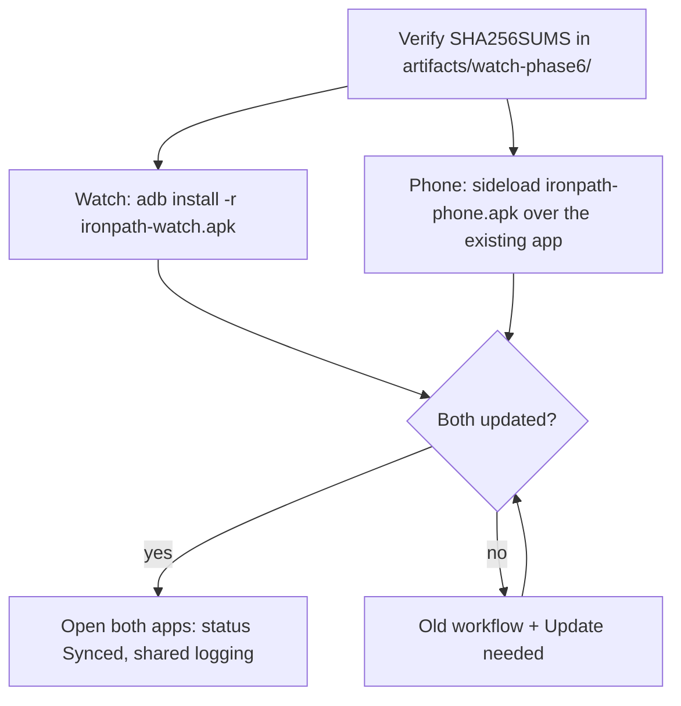

# Galaxy Watch7: install, train, and sync

Current pair: **phone 1.0.6 (code 7)** and **watch 0.5.0 (code 5)**, sync protocol v2.
The watch app is native Wear OS software. Both apps install directly from APKs;
an app store is not part of installation or normal operation.

With this pair you log sets and control rest from **either screen** during the same
workout. There is no routine **Take control on phone** step any more.

## Install or update

Use the matching APKs from `artifacts/watch-phase6/`: `ironpath-phone.apk`,
`ironpath-watch.apk`, plus `SHA256SUMS` and `build.json` for verification
(`sha256sum -c SHA256SUMS` inside that folder). These are debug-signed builds using
the existing signing identity (certificate `38255a75…1843`), not store releases.
Build outputs are ignored by Git; a source checkout does not contain the delivered
APKs or the private signing key.

**Update order: install BOTH apps.** Shared logging starts only when both sides run
the new versions. Until then the old compatible workflow stays active and both
screens show **Update needed** (see [Mixed versions](#mixed-versions)).



Install both **in place, without clearing data or uninstalling**. Workout history is
local to the phone, and the watch may hold queued actions; an in-place update keeps
both and upgrades their stored queues automatically.

**Phone:** install `ironpath-phone.apk` through the existing file-manager/browser
installation flow, over the installed app.

**Watch** (wireless ADB):

1. Enable Developer options, ADB debugging, and Wireless debugging on the watch.
   Keep the computer and watch on the same Wi-Fi network.
2. If the computer is not paired, open **Pair new device** and run
   `adb pair WATCH_IP:PAIRING_PORT`. Enter the displayed pairing code.
3. Return to the main Wireless debugging screen. Run
   `adb connect WATCH_IP:CONNECTION_PORT` using that screen's port. Pairing and
   connection ports are different and can change. Existing pairing can be reused.
4. Run `adb -s WATCH_IP:CONNECTION_PORT install -r ironpath-watch.apk`.
5. Open Ironpath from the watch app list. Turn debugging off when finished;
   phone/watch workout synchronization does not use ADB.

On this development computer, use `adb -P 15037 ...` for every command (for example
`adb -P 15037 -s WATCH_IP:CONNECTION_PORT install -r ironpath-watch.apk`) because
other applications occupy the default ADB server port. This computer-side port
is separate from the watch-side pairing/connection ports. `adb mdns services`
can discover an enabled watch's current connection endpoint.

Retain the same signing key on both devices. Do not uninstall the phone app to work
around a signature mismatch: its workout history is local. Back up that history
before changing devices or signing configurations.

## Normal workout

1. Start or resume the workout on the phone and complete its warm-up and any
   phone-only inputs.
2. Tap **Send workout to watch** to choose which workout the watch shows, and wait
   for confirmation. If several workouts are in progress, **Switch watch to this
   workout** moves the watch to another one after its saved actions sync.
3. Log from whichever screen is at hand. Phone edits appear on the watch and watch
   sets appear on the phone automatically; you never hand control back and forth.
4. Finish the workout on the phone (see [Finishing](#finishing)).

The phone keeps canonical workout history. Watch actions are saved on the watch
first and are committed to history when the phone app is open. Starting and
finishing a workout independently on the watch is outside this version.

### Watch screens

The workout is a pager; swipe left and right between three pages:

- **Now** shows the current set, or the rest screen while a rest runs.
  - **Current set:** exercise name (with a superset badge such as `A1`), set
    position, value tiles for reps and weight (`L / R` for per-side reps), and the
    target line. Values are pre-filled from what is already logged, then the target,
    then your previous set.
  - **Done set** (the button at the bottom edge) logs the values shown in one tap.
    The tap is your explicit acceptance; targets are never stored on their own.
  - **Changing a value:** tap its tile, turn the bezel/crown (one step per detent,
    for example 2.5 kg on a barbell), tap **Set**, then **Done set**. Swipe right
    to discard. **‹ Target ›** fills the target value.
  - **Undo:** an **Undo** pill shows for 6 seconds after Done set; later, use
    **Undo last set** on Progress.
  - Unsupported entry styles (time, distance, steps, treadmill) show **Log on
    phone**; rest still works.
- **Exercises** lists each exercise with working sets done/total. Tap one to jump
  to its next set.
- **Progress** shows working sets done/total, elapsed time, the sync row, and
  **Settings**.

**Rest screen.** A full-screen arc and countdown, **−15** / **+15**, **Skip**, and a
preview of the next set (tap it to look at that set while the rest keeps running).
Rest edits from the watch also update the phone, and the other way round. While
rest runs on another page, the time at the top shows the remaining rest; tap it to
return. In ambient mode the watch shows remaining minutes and the end time.

**Sync dot.** A small indicator next to the clock shows the sync state. Tap it for
details and **Retry now** or **Review**.

**Settings** (from Progress, or the gear on the idle screen) holds **Wrist alerts**,
**Precise rest alerts**, the optional 10-second warning, **Buzz in Do Not
Disturb**, **Test wrist alert**,
**Test phone connection**, and **Diagnostics**.

## Sync status

Both screens show one status, in this priority order:

| Status | Watch indicator | Meaning | What to do |
| --- | --- | --- | --- |
| **Update needed** | refresh icon + `Update` | Phone and watch versions differ. The old compatible workflow is in use. | Install both matching apps. |
| **Needs review** | warning triangle + `Review` | The same field of a set was changed differently on both screens. | Open the review (below). |
| **Waiting for phone** | phone icon | The phone received the watch actions but the phone app has not saved them to history yet. | Open Ironpath on the phone. |
| **Saved on watch** | hollow ring | Actions are safe on the watch but not yet received by the phone. | Bring the phone near; tap **Retry now** if needed. |
| **Synced** | filled dot | Everything is saved in phone history. | Nothing. |

The phone may also show **Offline** when the watch is out of reach and nothing is
pending: its actions are saved and sync when it reconnects.

## Conflict review

Different sets, or different fields of the same set, merge automatically. A review
appears only when the same field was changed to different values on both screens.

- **On the phone** (workout screen or Settings, under **Needs review**): a table
  lists every field of the change with **Phone now** next to the watch value. Fields
  marked *(no conflict)* are part of the same change but did not conflict. Choose
  **Keep phone values** or **Apply watch values**.
- **On the watch** (sync dot → **Review**, or the **Review** button that replaces
  **Done set** on the affected set): one
  conflict per screen, phone value above watch value. Choose **Keep phone** or
  **Use watch value**. If the phone is out of reach the choice is queued.

Applying a value is a new conditional change: if the set changed again meanwhile,
you get a fresh review instead of an overwrite. Only the set under review is locked;
other sets stay usable. Finishing waits until reviews are resolved.

## Finishing

Finish on the phone as usual. Ironpath then:

1. briefly freezes both screens (the watch shows **Finishing on phone**; the rest
   timer keeps running);
2. imports every action the watch has confirmed;
3. asks you to resolve any open review;
4. completes the workout once, and the watch shows **Workout saved** with a short
   summary.

If you cancel or finishing fails, both screens return to normal shared logging. If
the watch cannot be reached, the phone asks whether to **complete without** the
unconfirmed sets. Sets that arrive later are kept for review and never change the
completed workout; the watch then says some sets weren't saved.

## Rest alerts

There is one shared rest timer. Starting, −15, +15 and Skip work from either device.
The wrist alert is preferred. The phone keeps a backup "Rest complete" alert until
the watch confirms it has armed its alert for the current timer, so during an
uncertain disconnect you can get **both** alerts; that duplicate is accepted rather
than risking none. The phone's rest overlay says where the alert will fire
(**Alert on your watch**, **Alert on watch and phone**, or **No alert**). The
phone lock screen keeps a live countdown with the next set. Details:
[workout alerts](../docs/workout-alerts.md#rest-controls-and-lock-screen).

On the watch, enable **Wrist alerts** and allow **Precise rest alerts** where
available (the watch asks once at the first workout). **Test wrist alert** uses a
three-second test without changing workout sets. Notification permission, DND,
power saving, and OS scheduling can affect alerts.

## Diagnostics export

Each device keeps its latest 500 sync and alert events for up to 14 days. These are
stored separately from workout data and queued actions, which are never pruned.
The phone pulls the watch's events whenever they reconnect.

On the phone, open **Settings → Watch sync diagnostics** to see the counts and
latest events. **Fetch from watch** requests the newest watch events now, and
**Export diagnostics** saves `ironpath-diagnostics-YYYY-MM-DD.json` through the
share sheet. Nothing is uploaded automatically. The watch shows its latest events
under **Settings → Diagnostics**.

## Mixed versions

If only one app is updated, the pair keeps the old compatible workflow and shows
**Update needed** (the watch shows it once, then keeps the indicator). In that mode
the old **Take control on phone / sync watch** step returns: use it before editing
or finishing on the phone. Install the other app to restore shared logging. Queued
actions from the old version are still delivered. Do not uninstall or clear app data
to resolve pending actions.

## Verification status

Phone 1.0.6 / watch 0.5.0 passed 568 vitest tests in 39 files, 102 wear-link JUnit
tests and 33 watch unit tests, typechecking, ESLint, Android lint (app, wear,
wear-link), both APK builds, and matching signing-certificate checks. Behaviour was
verified on **emulators only**.

**Still pending on the physical devices:** one smoke workout on the Galaxy Watch7 and
phone covering both screens, reconnect, finish, and several screen-off rests.
Extended battery/Doze monitoring is a post-release follow-up using the diagnostics
above. See the [phase tracker](galaxy-watch-phases.md).

The previous pair (phone 1.0.5 / watch 0.4.0) was confirmed by the user for
installation, real workout handoff and return-to-phone sync.

## Rebuild the APK pair

Use Node 22+, JDK 21, and the Android SDK 36 setup described in the main README.
The existing signing key must be available outside the repository.

```bash
npm ci
npm run android:pair-apks
npm run watch:test
APKSIGNER="$ANDROID_HOME/build-tools/36.0.0/apksigner" \
  node scripts/package-watch-apks.mjs artifacts/watch-phase4/ironpath-phone.apk watch-phase6
```

The packaging step refuses mismatched phone/watch/baseline certificates and
writes the pair, hashes, and build metadata to `artifacts/watch-phase6/`.
